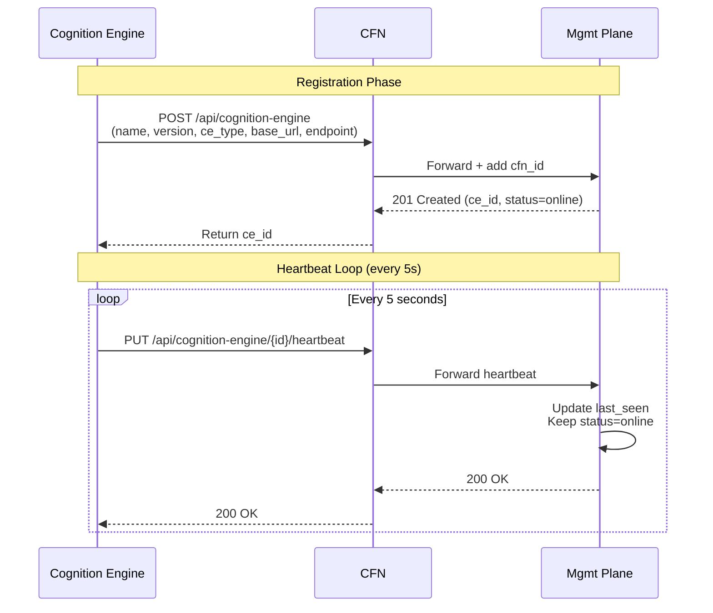
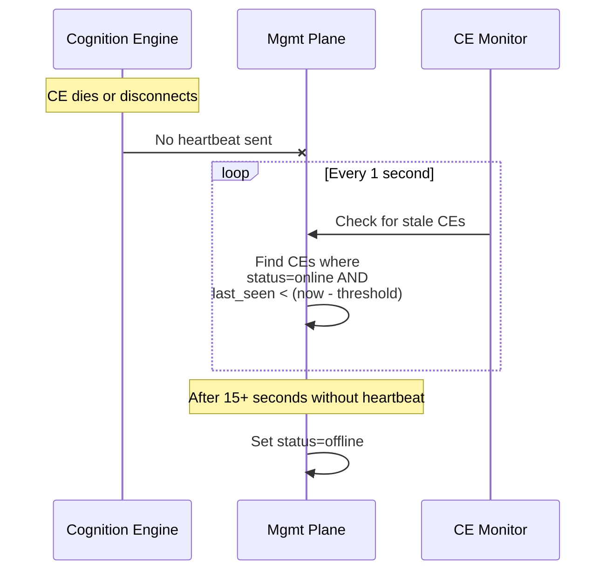
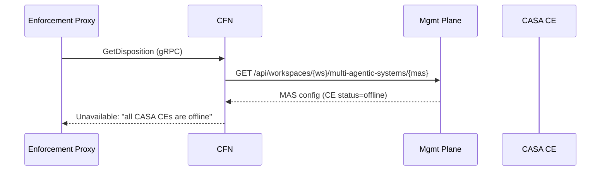
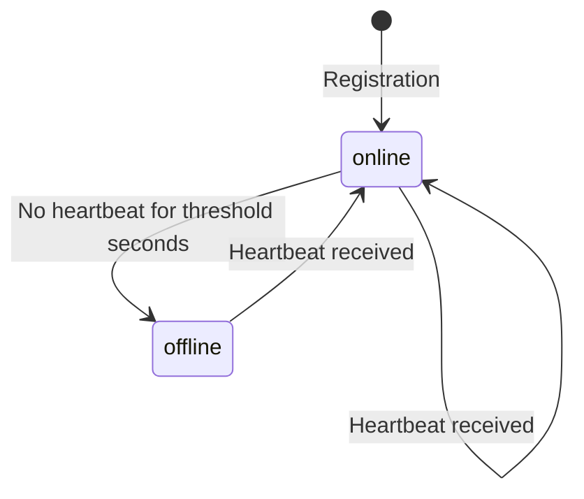
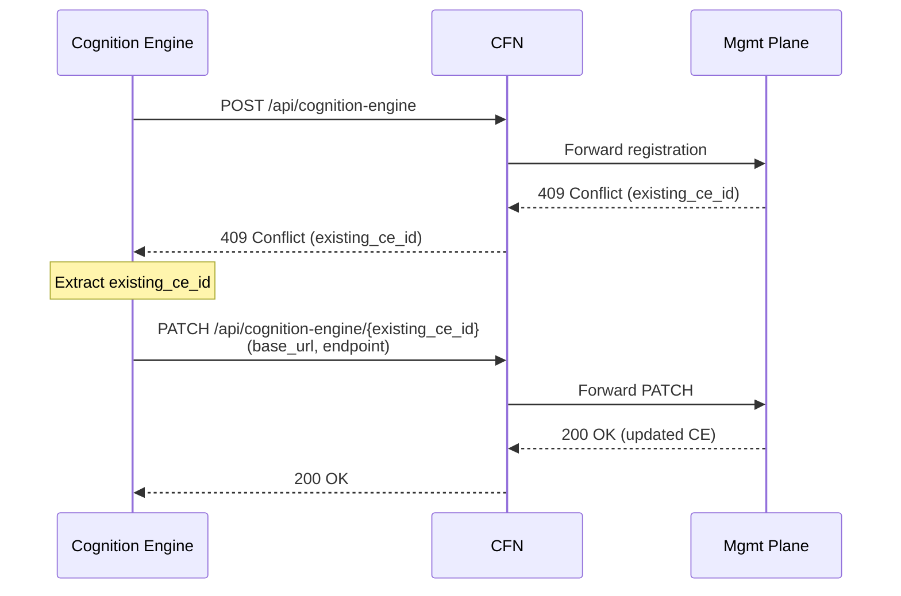

# Cognition Engine (CE) Lifecycle Management

This document describes how Cognition Engines register with the platform and how their online/offline status is managed.

## Overview

### CE Registration and Heartbeat Flow



### Offline Detection



### Enforcement Request with Offline CE



### Status Transitions



## Components

### 1. Cognition Engine (CE)

The CE is responsible for:
- **Registration**: On startup, POST to `/api/cognition-engine` with identity (name, version, ce_type, base_url, endpoint)
- **Heartbeat**: Send periodic PUT to `/api/cognition-engine/{ce_id}/heartbeat` to maintain online status
- **Graceful shutdown**: Stop heartbeats (CE will be marked offline after threshold)

### 2. Cognition Fabric Node (CFN)

The CFN acts as a proxy:
- Receives CE registration requests, adds `cfn_id`, forwards to Management Plane
- Forwards heartbeat requests to Management Plane
- When routing enforcement requests, selects the first healthy (online + enabled) CASA CE

### 3. Management Plane

The Management Plane is the source of truth for CE status:
- Stores CE records in the database
- Updates `last_seen` timestamp on each heartbeat
- Runs a background monitor that marks stale CEs as offline

## Configuration

### Management Plane Environment Variables

| Variable | Default | Description |
|----------|---------|-------------|
| `CE_MONITOR_CHECK_INTERVAL_SECONDS` | 1 | How often the monitor checks for stale CEs |
| `CE_OFFLINE_THRESHOLD_SECONDS` | 15 | Mark CE offline after this many seconds without heartbeat |

### CE Environment Variables

| Variable | Default | Description |
|----------|---------|-------------|
| `CE_HEARTBEAT_INTERVAL_SEC` | 5 | How often the CE sends heartbeats |

### Recommended Configuration

The heartbeat interval should be significantly less than the offline threshold to allow for network hiccups:

```
CE heartbeat interval < offline threshold / 3
```

Example (default configuration):
- CE sends heartbeat every **5 seconds**
- Monitor checks every **1 second**
- CE marked offline after **15 seconds** (3 missed heartbeats)

This means:
- Best-case offline detection: ~15 seconds after CE dies
- Worst-case offline detection: ~16 seconds (15s threshold + 1s check interval)

## Error Handling

### Registration Conflicts (409)

If a CE with the same `(cfn_id, name, version)` already exists:



This handles CE restarts where the address may have changed (new IP, different port).

### CFN CE Selection

When CFN receives an enforcement request:

1. Fetch MAS configuration from Management Plane (includes associated CEs)
2. Find all CASA CEs for this MAS
3. Select first CE that is both `enabled=true` AND `status=online`
4. If no healthy CE found, return appropriate error:
   - `NotFound`: No CASA CE associated with MAS
   - `Unavailable`: CASA CEs exist but all are disabled
   - `Unavailable`: CASA CEs exist but all are offline
   - `Unavailable`: Mix of disabled and offline (includes counts)

## Future Considerations

### Graceful Shutdown Notification

Currently, when a CE shuts down gracefully, it simply stops sending heartbeats and waits to be marked offline after the threshold. This could be improved by having CEs send an explicit shutdown notification:

- CE calls `DELETE /api/cognition-engine/{ce_id}/status` or similar on shutdown
- Management Plane immediately marks CE as offline
- CFN stops routing requests to that CE instantly

This would eliminate the detection delay for planned shutdowns (deployments, scaling down, maintenance).

### Circuit Breaker

For instant failure detection on the request path, a circuit breaker can be added to CFN:

- Track consecutive connection failures per CE
- After N failures, open the circuit (stop trying that CE)
- Reset circuit on successful heartbeat or after cooldown period

This complements the heartbeat-based detection by providing immediate feedback when a CE fails mid-request, rather than waiting for the heartbeat timeout.
