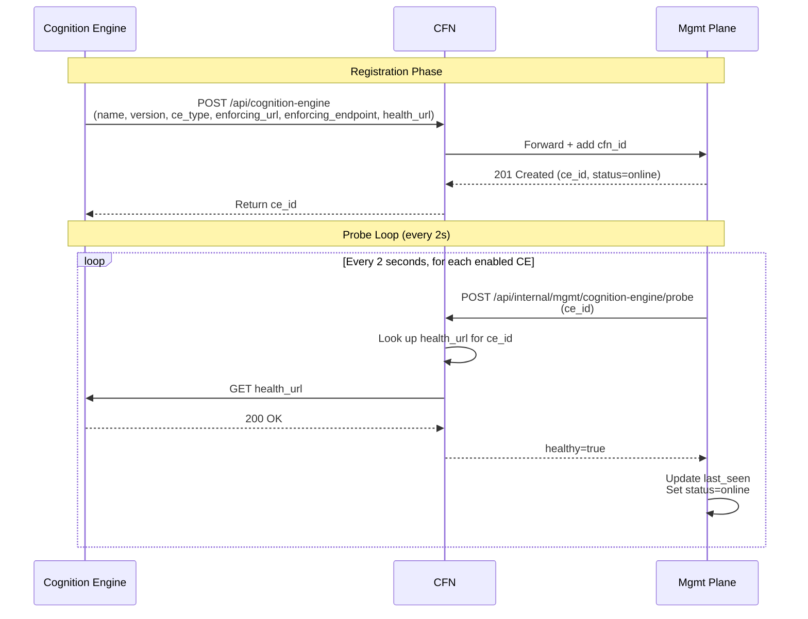
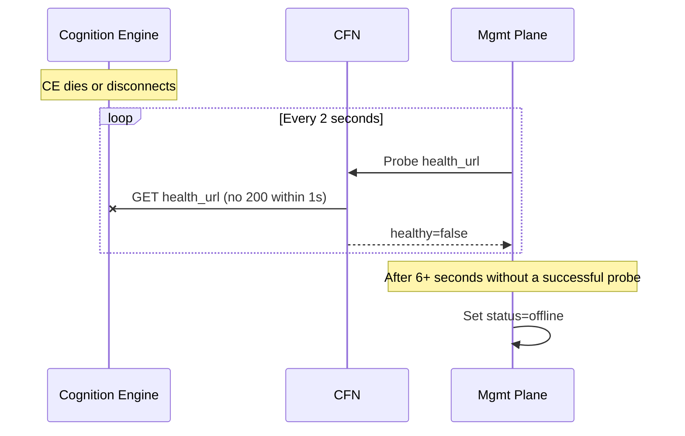
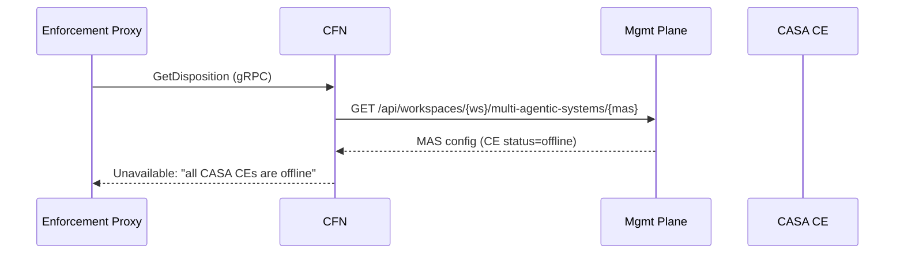
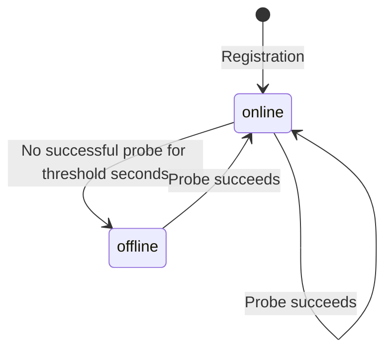
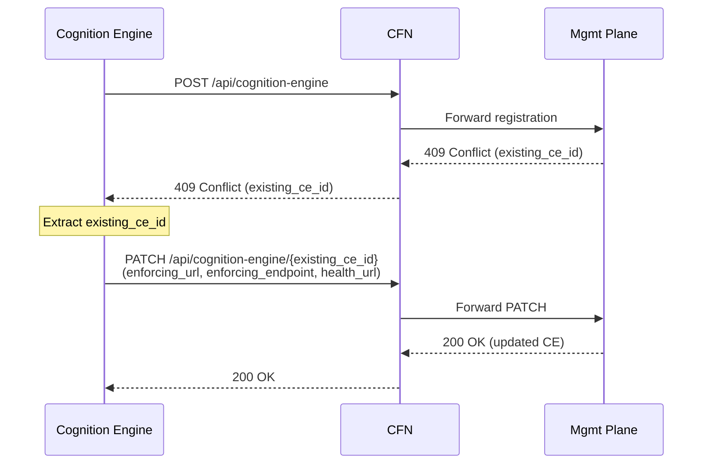

# Cognition Engine (CE) Lifecycle Management

This document describes how Cognition Engines register with the platform and how their online/offline status is managed.

## Overview

### CE Registration and Health Probe Flow



### Offline Detection



### Enforcement Request with Offline CE



### Status Transitions



## Components

### 1. Cognition Engine (CE)

The CE is responsible for:
- **Registration**: On startup, POST to `/api/cognition-engine` with identity (name, version, ce_type), an optional enforcing address (`enforcing_url`, `enforcing_endpoint`) and a required `health_url` and `health_endpoint`. See [Endpoint fields](#endpoint-fields)
- **Health endpoint**: Serve `health_endpoint` on `health_url` (for example `GET /healthz`) unauthenticated and return `200` while the CE is up. The body is ignored.
- **Graceful shutdown**: Stop serving the health endpoint (CE will be marked offline after threshold)

### 2. Cognition Fabric Node (CFN)

The CFN acts as a proxy:
- Receives CE registration requests, adds `cfn_id`, forwards to Management Plane
- Validates `health_url` (absolute http or https URL with a hostname, no credentials, no fragment, no link-local address such as the cloud metadata address 169.254.169.254) and exposes an internal probe endpoint (`POST /api/internal/mgmt/cognition-engine/probe`, body `{"ce_id": ...}`). CFN looks up the CE's registered `health_url` in its config snapshot and performs the HTTP GET against it, so callers cannot make CFN probe arbitrary URLs. A `200` within the timeout (default 1s, max 10s, `CE_PROBE_TIMEOUT_SECONDS`, read at startup) is healthy, anything else is unhealthy. Redirects are not followed and `HTTP_PROXY` and `HTTPS_PROXY` are ignored. A `ce_id` that is not in the snapshot returns `404` (`CE not yet in CFN config`), which mgmt counts as unhealthy. CFN refreshes its snapshot shortly after any CE registration, patch or delete that goes through it, and on its own heartbeat to the management plane when the config version changed. A `health_url` changed directly on the management plane therefore reaches CFN with its next config pull (`HEARTBEAT_INTERVAL_SECONDS`, 10 seconds by default), and until then CFN probes the old URL.
- When routing enforcement requests, selects the first healthy (online + enabled) CASA CE

### 3. Management Plane

The Management Plane is the source of truth for CE status:
- Stores CE records in the database
- Runs a background monitor that asks CFN to probe every enabled CE and sets `status` from the result
- Keeps `last_seen` as the time of the last successful probe

## Endpoint fields

A CE declares one address per purpose. Each has the same shape, a `*_url`, an optional `*_endpoint` and a `*_protocol`:

| Purpose | Fields | Protocol | Notes |
|---------|--------|----------|-------|
| Enforcing | `enforcing_url`, `enforcing_endpoint`, `enforcing_protocol` | `grpc` (default) | `enforcing_url` is a gRPC `host:port`, `enforcing_endpoint` is the gRPC service name (for example `ioc.ce.v1.CognitionEngine`). Enforcing is optional, but the two are set together |
| Health | `health_url`, `health_endpoint`, `health_protocol` | `http` (default) | `health_url` is the base URL and `health_endpoint` the path; CFN probes their join with a GET |
| Notification (optional) | `notification_url`, `notification_endpoint`, `notification_protocol` | `http` (default) | `notification_url` is a base URL and `notification_endpoint` is the path |

Validation:
- `enforcing_url` and `enforcing_endpoint` must be set together, because a gRPC address has no service name. A CE with neither is never called for enforcement.
- `health_endpoint` (required) and `notification_endpoint` must start with `/`.
- `notification_url` and `notification_endpoint` must be set together, since CFN skips a CE that has only one.
- Each purpose accepts only the protocol CFN speaks for it today. Any other value is a 400.
- On `PATCH`, an explicit `null` clears `enforcing_url`, `enforcing_endpoint`, `notification_url` or `notification_endpoint`.

`enforcing_url` and `enforcing_endpoint` replace the earlier `base_url` and `endpoint`.

## Configuration

### Management Plane Environment Variables

| Variable | Default | Description |
|----------|---------|-------------|
| `CE_PROBE_INTERVAL_SECONDS` | 2 | How often the monitor probes each CE |
| `CE_PROBE_TIMEOUT_SECONDS` | 1 | Probe timeout |
| `CE_OFFLINE_THRESHOLD_SECONDS` | 6 | Mark CE offline after this many seconds without a successful probe |
| `CFN_SVC_URL` | `http://localhost:9002` | CFN base URL the monitor calls to probe CEs |

### CFN Environment Variables

| Variable | Default | Description |
|----------|---------|-------------|
| `CE_PROBE_TIMEOUT_SECONDS` | 1 | Timeout for the GET CFN performs against a CE `health_url` |

### Recommended Configuration

The offline threshold should be at least three probe intervals to allow for network hiccups:

```
offline threshold >= 3 x probe interval
```

Example (default configuration):
- Mgmt probes every **2 seconds**
- A probe fails after **1 second** without a `200`
- CE marked offline after **6 seconds** (three missed probes)

This means:
- Best-case offline detection: ~6 seconds after CE dies
- Worst-case offline detection: ~8 seconds (6s threshold + 2s probe interval)

## Error Handling

### Registration Conflicts (409)

If a CE with the same `(cfn_id, name, version)` already exists:



This handles CE restarts where the address may have changed (new IP, different port).

### CFN CE Selection

When CFN receives an enforcement request:

1. Fetch MAS configuration from Management Plane (includes associated CEs)
2. Find all CASA CEs for this MAS
3. Select first CE that is both `enabled=true` AND `status=online`
4. If no healthy CE found, return appropriate error:
   - `NotFound`: No CASA CE associated with MAS
   - `Unavailable`: CASA CEs exist but all are disabled
   - `Unavailable`: CASA CEs exist but all are offline
   - `Unavailable`: Mix of disabled and offline (includes counts)

## Future Considerations

### Graceful Shutdown Notification

Currently, when a CE shuts down gracefully, it simply stops answering probes and waits to be marked offline after the threshold. This could be improved by having CEs send an explicit shutdown notification:

- CE calls `DELETE /api/cognition-engine/{ce_id}/status` or similar on shutdown
- Management Plane immediately marks CE as offline
- CFN stops routing requests to that CE instantly

This would eliminate the detection delay for planned shutdowns (deployments, scaling down, maintenance).

### Circuit Breaker

For instant failure detection on the request path, a circuit breaker can be added to CFN:

- Track consecutive connection failures per CE
- After N failures, open the circuit (stop trying that CE)
- Reset circuit on successful probe or after cooldown period

This complements probe-based detection by providing immediate feedback when a CE fails mid-request, rather than waiting for the offline threshold.
