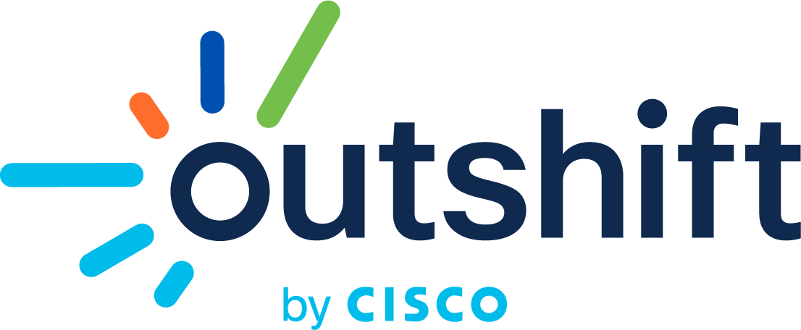

# ci-tkf-csp-ui-svc

    
    <a href='#'>JENKINS BUILD</a>
    
    
        <a href="http://www.typescriptlang.org/">
        
    
    
        <a href="https://react.dev/">
        
    
  

 

  <a href="https://outshift.cisco.ai/">
    <picture>
      <source media="(prefers-color-scheme: dark)" srcset="img/_logo-Outshift_1C-WHITE@2x.png" width="300">
      
    </picture>
  </a>
   
  <caption>Welcome to the <b>ci-tkf-csp-ui-svc</b> repo</caption>

---

# Development

## Setup

### Authentication

Since this project is using the [`@outshift/auth-providers-react`](https://github.com/cisco-eti/auth-providers-react) package you will
need to authenticate to artifactory packages.

- To do so, please go to [link](https://probable-adventure-375q1zy.pages.github.io/#/installation/index?id=eti-sre-npm) to extract the `TOKEN` to authenticate in artificatory.

- environment variable named `ARTIFACTORY_PASSWORD`.

We also use `@magnetic/design` - [link](https://magnetic.cisco.com/0a43ab5cd/p/656727-magnetic-design-system). But because it shares the same domain as `@outshift/auth-providers-react` lib you can use the same `ARTIFACTORY_PASSWORD` to setup on your `.yarnrc.yml` file.

## Available Scripts

Install dependencies

### `yarn install`

In the project directory, you can run:

### `yarn dev`

Runs the app in the development mode.\
Open [http://localhost:3000](http://localhost:3000) to view it in the browser.

The page will reload if you make edits.\
You will also see any lint errors in the console.

### `yarn test`

Launches the test runner in the interactive watch mode.\

### `yarn run build`

Builds the app for production to the `build` folder.\
See the section about [running tests](https://facebook.github.io/create-react-app/docs/running-tests) for more information.
