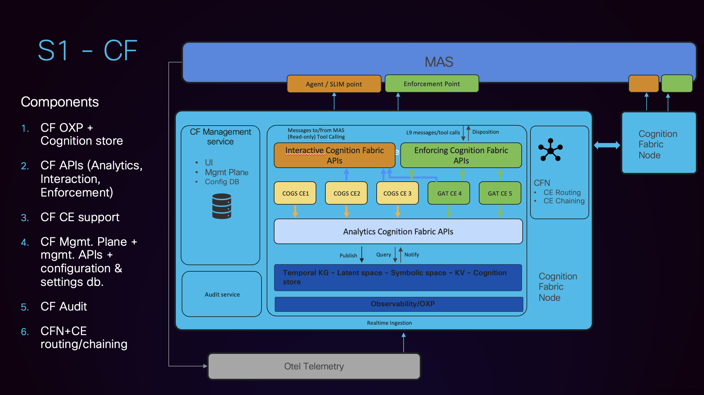

# Architecture

<!-- kind: source · source of truth: GitHub (this file) -->

The architecture of record for Cognition Fabric (CF).

## High-level architecture

## Components

### 1. OXP + Cognition Store (OXP-owned)

The data layer (owned by OXP) providing:
- **Temporal KG** — temporal knowledge graph
- **Latent space** — vector embeddings
- **Symbolic space** — symbolic representations
- **KV** — key-value storage
- **Cognition** — cognitive state

Fed by **Observability/OXP** through realtime ingestion, with **Otel Telemetry** as an upstream source.

### 2. CF APIs (Active, Enforcing) + OXP Analytics APIs

Two-tier CF API surface, with Analytics owned by OXP:

| Tier | APIs | Owner | Purpose |
|------|------|-------|---------|
| **Analytics** | Analytics APIs | OXP | Read-only observability — CEs query traces, trajectories, metrics directly from OXP |
| **Active** | Active Cognition Fabric APIs | CF | Direct MAS engagement — CEs send messages, query tools |
| **Enforcing** | Enforcing Cognition Fabric APIs | CF | Block / modify / inject via Enforcement Proxy in-path |

The diagram shows:
- **Active Cognition Fabric APIs** receiving messages to/from MAS and tool calling
- **Enforcing Cognition Fabric APIs** handling L9 messages/tool calls with disposition
- **Analytics APIs (OXP-owned)** providing read access to the Cognition Store

### 3. CF CE Support

Cognition Engines connect to the APIs:
- **COGS CE1, CE2, CE3** — connected to Active APIs
- **GAT CE 4, GAT CE 5** — connected to Enforcing APIs
- CEs needing read-only observability connect directly to OXP's Analytics APIs

### 4. CF Mgmt. Plane + mgmt. APIs + configuration & settings db.

The **CF Management service** provides:
- UI
- Mgmt Plane
- Config DB

### 5. CF Audit

**Audit service** for compliance and observability.

### 6. CFN + CE routing/chaining

The **Cognition Fabric Node (CFN)** handles:
- CE Routing
- CE Chaining

## Data flow

### MAS to CF

1. **Agent / SLIM point** — MAS agents connect via SLIM or direct agent protocols
2. **Enforcement Point** — in-path enforcement via the Enforcement Proxy
3. Messages and tool calls flow to Interactive and Enforcing APIs

### CF to Cognition Store

1. APIs perform **Publish**, **Query**, **Notify** operations against the Cognition Store
2. Realtime ingestion from Observability/OXP populates the store
3. Otel Telemetry feeds into Observability/OXP

### CE interactions

1. COGS CEs connect to Active APIs for direct MAS engagement
2. GAT CEs connect to Enforcing APIs to issue dispositions
3. All CEs can query OXP's Analytics APIs directly for read-only access

## Key contracts

| Contract | From | To | Protocol | Purpose | Status |
|----------|------|-----|----------|---------|--------|
| `ioc.cf.enforcement.v1.Enforcement/GetDisposition` | Enforcement Proxy | CF | gRPC | Enforcing API — dispositions (`allow`/`block`/`modify`) | [Under discussion](discussions/0001-enforcement-api-contract.md) |
| `ioc.cf.tracing.v1` | Enforcement Proxy | CF | TBD | Tracing contract — correlated traces | Not started |
| L9 message schema | L9 T3 | CF | — | Message and interaction semantics | Dependent on L9 T3 |

## Deployment

CF deploys as a set of microservices:
- **CF Management service** — management plane, UI, config
- **Cognition Fabric Node** — API gateway, CE routing
- **Cognition Store (OXP-owned)** — data layer (KG, vector, KV)
- **Audit service** — compliance logging

## Related documents

- [Charter](charter.md) — problem statement, scope, goals
- [Dependencies](dependencies.md) — project-level relationships
- [Decisions](decisions/README.md) — Architecture Decision Records
- [Specs](specs/README.md) — detailed specifications
