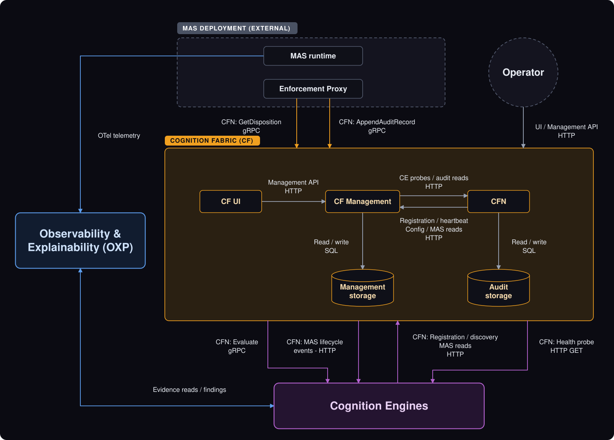
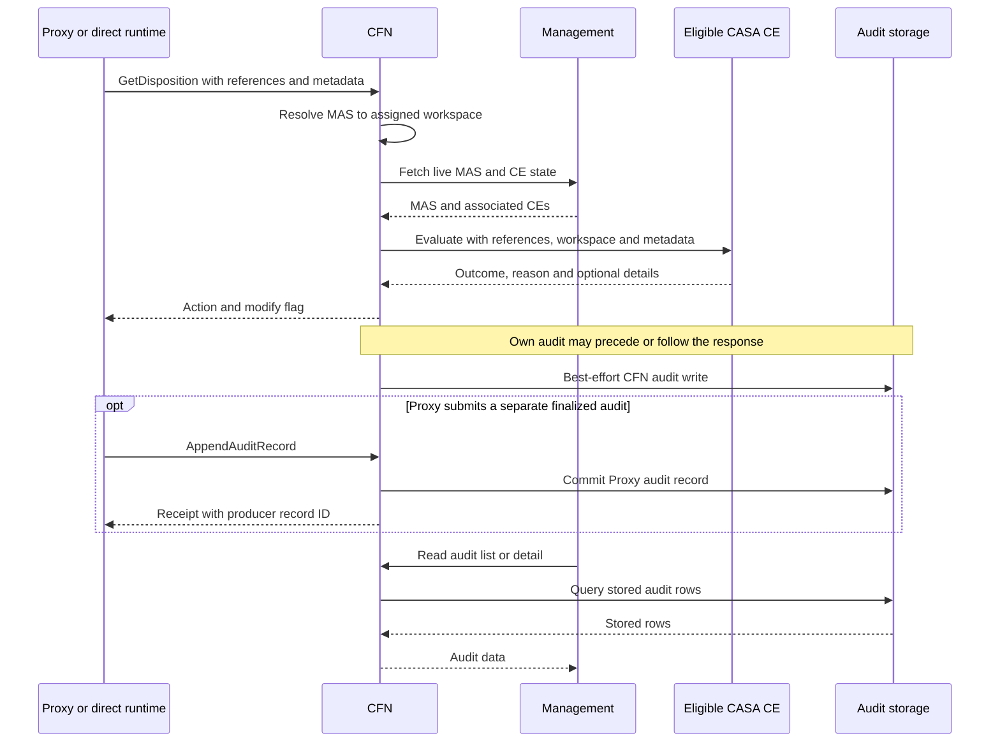
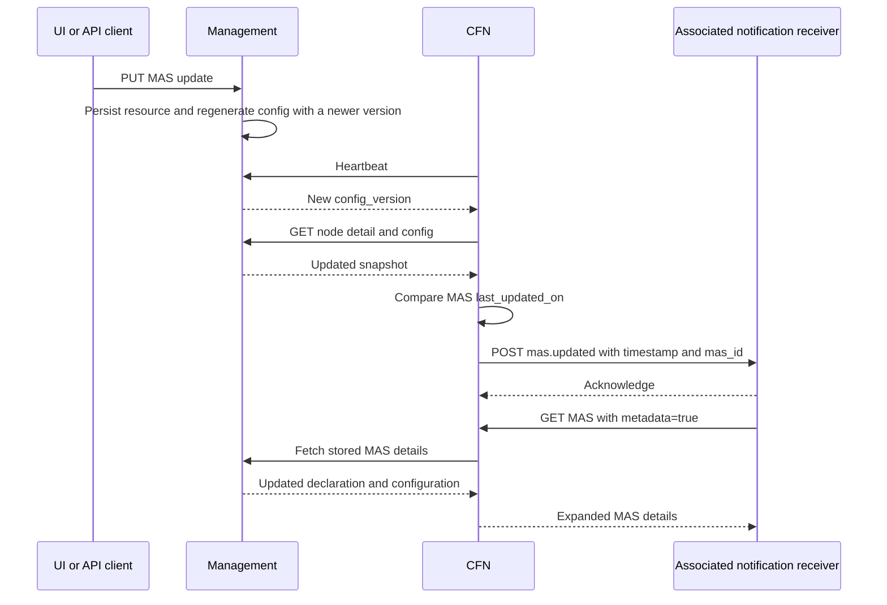

# Cognition Fabric architecture

<!-- kind: source · source of truth: GitHub (this file) -->

This document describes the current Cognition Fabric implementation.

## Purpose and boundary

Cognition Fabric (CF) connects multi-agent systems (MAS) to Cognition Engines
(CEs) that evaluate policy or analyze evidence. The Enforcement Proxy mediates
configured interactions and asks the Cognition Fabric Node (CFN) for a
disposition. CFN routes the request to one eligible CE and records audit
evidence. The **System for Cognitive Observability, Provenance and Explainability
(SCOPE)** processes MAS telemetry, owns the Cognition Store and serves Analytics
APIs that CEs call directly.

CF manages workspaces, CFN and CE registrations, and MAS definitions, including
declared agents, tools, configuration and assignments. It tracks component
health, delivers MAS lifecycle notifications and exposes audit evidence.

The three core components are **CF Management**, **CF UI** and **CFN**. They are
delivered as separate application container images. Two example CE images, **Go Demo CE** and
**Python Template CE**, provide reference implementations of the CE interfaces.
Although these examples are maintained in the monorepo, they interact with CF as
separate CE processes through the same contracts as other engines.

The MAS runtime, Enforcement Proxy, SCOPE and production CEs sit outside CF's
service boundary.

The monorepo builds the PostgreSQL-based **`ioc-scale-db`** image and deploys it
as the shared database server for CF and SCOPE. The server hosts separate databases
for CF Management inventory and configuration, CFN audit records, and the
SCOPE-owned Cognition Store. The deployment stack and enforcement overlays live in
[`deploy/`](../deploy/README.md).

## Internal components

| Component | Responsibility | Main relationships |
| --- | --- | --- |
| **CF Management** | Owns workspaces, CFN/CE registrations, MAS declarations, assignments and configuration. Generates versioned CFN configuration and records health state. | Serves CF UI and internal CFN operations; asks CFN to probe CEs. |
| **CF UI** | Provides administration, onboarding, assignment/configuration controls and audit inspection. | Calls Management APIs; audit data is read through Management. |
| **CFN** | Exposes runtime CE and Enforcement interfaces. Resolves MAS/workspace ownership, invokes the selected CE, probes health, detects MAS changes and dispatches callbacks. | Registers with and heartbeats Management; reads configuration and live MAS state; calls CEs; stores audit records. |
| **Management storage** | PostgreSQL persistence for inventory, declarations, associations and generated configuration. | Written and read by Management. |
| **Audit storage** | PostgreSQL persistence for CFN-produced and ingested Proxy records. | Written/read by CFN; exposed through CFN and Management audit APIs. |

The shared `api/` module holds interface contracts and bindings.



The Enforcement Proxy runs alongside the MAS runtime and calls CFN through
separate RPCs for enforcement decisions and audit submission. The diagram shows
the MAS deployment at the level of its external interfaces.

CE registration, MAS reads, evaluation, health probes and lifecycle callbacks
are separate flows. RPC and HTTP responses return on the corresponding request
connection.

## State and identity

A workspace groups MAS definitions and their configuration and assigns them to
the Cognition Fabric Node that serves them. The standard MAS workflow uses the
**Default Workspace** automatically.

Management is authoritative for resource definitions and associations. CE/MAS
associations determine which engines may be selected. An associated CE must
belong to the CFN serving the MAS's workspace.

CF assigns the canonical MAS ID during onboarding. Enforcement callers and CE
evidence queries use that identity, and CFN uses it to resolve the workspace.
Callers use the agent and tool identities from the MAS declaration. For a
disposition request, CFN checks that the source and destination identifiers are
present and passes them unchanged to the selected CE for interpretation.

A CFN keeps an in-memory configuration snapshot containing its assigned workspaces,
MAS and CE information. Management versions generated configurations. CFN learns
about newer versions through its heartbeat and fetches its node detail/configuration
from Management. Enforcement also reads live MAS/CE state from Management.

CF-owned timestamps represent UTC instants. CE-provided timestamp strings and
arbitrary CE evidence retain their own meaning; CF does not normalize them into
claims about when CF performed an operation.

## API boundaries

CF exposes public APIs for integration with other IoC components, including MAS
runtimes, the Enforcement Proxy and CEs. Management REST is an internal CF
interface used by the UI, CFN and administrative tooling.

### Trust and security

The backend APIs assume a trusted deployment network. Management handles resource
requests as the built-in administrator independently of browser sign-in. CFN
serves unauthenticated plaintext gRPC and HTTP. CE REST and the internal
Management routes share the HTTP listener. CFN also uses plaintext gRPC for CE
evaluation.

CFN's shared outbound HTTP client skips certificate verification on HTTPS
requests to Management and CE lifecycle callbacks. CE health probes use
standard TLS certificate verification.

### Enforcement API (Enforcing tier) — caller to CFN

`ioc.cf.enforcement.v1.Enforcement/GetDisposition` is a synchronous gRPC operation.
The caller sends `mas_id`, source/destination agent IDs, `trace_id`, `span_id` and
optional string metadata in `extra`.

Each CE registers a type. `CASA` is the enforcement type, and `DETECTIVE` is the
investigation and analysis type. CFN resolves the assigned workspace and fetches
current MAS/CE state. It selects the first eligible `CASA` CE in the association
order returned by Management, which carries no guaranteed priority. Eligibility
requires an association with the MAS, enabled and online status, and an enforcing
address. CFN invokes that CE's `Evaluate` with the reference identifiers, resolved
workspace and metadata.

| CE outcome | CFN response | Meaning |
| --- | --- | --- |
| `DECISION_ALLOW` | `ACTION_ALLOW`, `modify=false` | Caller may continue unchanged. |
| `DECISION_DENY` | `ACTION_BLOCK`, `modify=false` | Caller applies the policy block. |
| `DECISION_MODIFY` | `ACTION_MODIFY`, `modify=true` | Modification requested. CFN omits the CE's `modified_action` payload. |
| Unspecified or unrecognized outcome | `ACTION_UNSPECIFIED`, `modify=false`, gRPC OK when the CE RPC succeeded | Caller applies its failure policy. |

CFN returns a gRPC error when no CE is eligible or when a lookup, CE connection
or CE RPC fails. The caller applies the returned disposition.

The Management lookup has a 30-second timeout per attempt and up to three
retries, with waits of one, two and four seconds. Its configured time budget is
127 seconds. CE connection and evaluation each have a 30-second timeout. Callers
should set an end-to-end deadline.

### Audit ingestion API — Proxy to CFN

`ioc.cf.enforcement.v1.Enforcement/AppendAuditRecord` accepts a finalized Proxy
evidence record independently of disposition evaluation. SCOPE handles MAS
telemetry ingestion and Cognition Store findings through its own interfaces.

The producer supplies a stable `audit_record_id` and correlation identifiers.
CFN validates the record and commits it before acknowledging that producer ID.
An identical replay returns the same receipt without another stored row;
different contents under the same ID are rejected. Validation/size violations,
storage failures and conflicting retries have explicit gRPC error semantics.

Ingested rows use `source=PROXY` and `audit_type=PROXY_MEDIATED`. The generic stored
row ID differs from the producer's `audit_record_id`. Records retain the producer's
evidence, including the applicable authorization, mediation or response-observation
shape.

### CE API — registration, discovery and evaluation

The CE interface has operations in both directions:

| Direction | Interface | Purpose |
| --- | --- | --- |
| CE → CFN | `POST /api/cognition-engine` | Register identity and callback addresses; CFN forwards registration to Management. |
| CE → CFN | `PATCH /api/cognition-engine/{ceId}` | Recover/update an existing registration after a conflict or reconnect. |
| CE → CFN | `DELETE /api/cognition-engine/{ceId}` | Unregister a disabled CE with no active MAS associations. |
| CE → CFN | `GET /api/cognition-engine/{ceId}/multi-agentic-systems` | Discover the MAS IDs associated with this CE. |
| CE → CFN | `GET /api/multi-agentic-systems/{masId}?metadata=true` | Pull stored onboarding metadata and CE-specific MAS configuration. |
| CFN → CE | `ioc.ce.v1.CognitionEngine/Evaluate` | Obtain outcome, reason and optional CE-owned details. |
| CFN → CE | HTTP GET to registered health address/path | Perform the background liveness probe. |

Registration requires a health URL and endpoint. Enforcing and notification
URL/endpoint pairs are optional. A CE without an enforcing address can participate
in other lifecycle operations but is not eligible for enforcement selection.
Management tracks endpoint ownership so an obsolete registration cannot become
healthy merely because another process reused its address. Stale probe results
from an earlier ownership generation are ignored.

MAS discovery reads CFN's configuration snapshot. During initial sync, CEs
retry `404` while waiting for their registration to appear in the snapshot and
`503` while the snapshot is unavailable. A `200` with an empty list means the
CE has no MAS associations.

The CE gRPC contract defines `GetInfo` for capability metadata. MAS reads return
the base response by default. CEs request expanded onboarding metadata by setting
`metadata=true`.

### Event API — CFN to CE

MAS lifecycle events are HTTP callbacks to the CE's registered notification URL
and path. The current event types are `mas.created`, `mas.updated` and `mas.deleted`.
The body contains only:

```json
{
  "event_type": "mas.updated",
  "timestamp": "2026-11-17T12:00:00Z",
  "mas_id": "550e8400-e29b-41d4-a716-446655440000"
}
```

This is a ping-and-pull contract. An associated CE acknowledges the callback, then
can fetch current MAS details from CFN in a separate request. On deletion it drops
the corresponding local state.

Delivery is asynchronous and best effort, with bounded HTTP retries that can
repeat a payload. There is no durable event queue, replay-on-registration or
exactly-once guarantee. An update uses the post-change CE associations; a CE
removed from a still-existing MAS does not currently receive a dedicated
`mas.disassociated` event. SCOPE telemetry and event delivery use their own
interfaces.

### Internal coordination and audit reads

Management uses one configured CFN endpoint for CE probes and audit reads. In
the standard deployment, that endpoint serves **Default Workspace**.

| Caller → provider | Interface | Role |
| --- | --- | --- |
| CFN → Management | `POST /api/cognition-fabric-nodes/register` | Register the runtime and obtain its initial identity/configuration. |
| CFN → Management | `PUT /api/cognition-fabric-nodes/{id}/heartbeat` | Update node liveness and receive `config_version`. |
| CFN → Management | `GET /api/cognition-fabric-nodes/{id}` | Read the node detail containing its generated configuration. |
| Management → CFN | `POST /api/internal/mgmt/cognition-engine/probe` with `ce_id` | Ask CFN to probe a registered CE. |
| Management → CFN | `GET /api/internal/mgmt/audit` and `/{eventId}` | Read stored runtime/Proxy audit rows. |
| UI/tooling → Management | Management REST, including `/api/workspaces/...` and `/api/audit-events/` | Administer resources and read audits through the control plane. |

The Management and CE OpenAPI documents define the full request schemas and
response codes.

## Onboarding and configuration

Onboarding establishes consistent definitions and associations before a runtime
request is evaluated. The following is a logical workflow, not a requirement to
recreate existing resources on every service start.

1. **Register and assign CFN.** CFN registers with Management at startup and
   receives its generated configuration. Management assigns **Default Workspace**
   on first registration when the node name matches its configured default CFN
   name and the workspace is unassigned.
2. **Declare the MAS.** An operator/provider uses the UI or Management
   `POST /api/workspaces/{workspace_id}/multi-agentic-systems`. The declaration can
   include agents, runtime tools, Model Context Protocol (MCP) bindings, provided
   topology, documentation and configuration. Management validates and persists
   the declaration and returns the canonical MAS ID.
3. **Register the CE.** The running CE registers through CFN, advertising its health
   and optional enforcing/notification addresses. A duplicate identity can return
   a conflict with the existing CE ID; the CE recovers through the supported PATCH.
4. **Establish CE/MAS associations.** Management accepts an explicit CE list on
   MAS creation or update and provides a dedicated API to add a CE to an
   existing MAS. During MAS creation and update, it also attaches enabled CEs
   on the workspace's CFN that are configured for auto-association. On creation,
   the explicit list adds to the automatically associated set. On update, a
   supplied list determines the final set. Each new association starts with a
   copy of the CE's default MAS configuration, which can be overridden for that
   MAS.
5. **Synchronize runtime state.** Management regenerates the relevant CFN config
   version. CFN discovers it through heartbeat/config refresh. A restarted CE
   discovers associated MAS IDs and pulls details; registration and the initial
   CFN snapshot do not replay historical lifecycle events.
6. **Connect the caller.** Configure the MAS runtime/Proxy to use the canonical MAS
   and runtime agent/tool identities and the correct CFN.

Onboarding stores references to external documents and registry records as
supplied metadata. The
[MAS metadata contract](../api/mgmt/docs/MAS_METADATA.md)
defines the supported reference fields.

Update a MAS through Management
`PUT /api/workspaces/{workspace_id}/multi-agentic-systems/{mas_id}`. Supplying `config`
replaces the entire configuration object, so preserve unrelated keys. Management
persists the update and regenerates the CFN configuration. CFN applies the change
during configuration refresh.

## Runtime relationships

### Health and configuration loops

**CE health:** Management's monitor asks CFN to probe the registered CE. CFN resolves
the saved health URL/path and performs a direct HTTP GET. HTTP 200 within the
configured timeout is healthy; the response body is ignored. Management advances
CE `last_seen` on success and maintains online/offline state. The service defaults
are a two-second probe interval, one-second probe timeout and six-second offline
threshold; deployment overrides can differ.

**CFN health:** CFN sends its own heartbeat to Management, which records node
`last_seen` and returns the current config version. A newer version triggers a
config pull. The default heartbeat interval is ten seconds. Management checks
every 60 seconds and marks an online CFN offline when its last heartbeat is more
than two minutes old.

### Enforcement and audit readback



CFN records `CE_INVOKED` for an attempted CE evaluation and `CE_NOT_INVOKED` for
earlier failures. These own audits are asynchronous best-effort writes and do not
delay a decision until persistence. Proxy ingestion has its separate commit-before-
receipt guarantee. Both producers use the common audit read surfaces.

A completed policy denial is successful CF processing. Audit records distinguish
the disposition outcome from processing success, which can be unset on Proxy
mediation records. MAS, trace/span and actor identifiers correlate the records.

### MAS update, notification and pull



The notification recipient can differ from the CE chosen for enforcement. The
initial snapshot establishes the baseline for subsequent notifications.

## NOA A2A reference deployment

NOA A2A is the trip-planning reference deployment for CF. The NOA API passes
client requests to the moderator agent. The Envoy Enforcement Proxy mediates
configured Agent2Agent (A2A) messages, MCP tool calls and large language model
(LLM) requests. The Proxy calls CFN for dispositions (`GetDisposition`) and
submits finalized audit records (`AppendAuditRecord`). NOA sends OpenTelemetry
traces through the collector to SCOPE, with trace and span IDs linking them to
Proxy and CFN records carrying the canonical MAS ID.

[NOA A2A deployment guide](../dev/README.md#noa-onboarding-and-proxy-mode)

## Current limits and future capabilities

- **Active APIs and CE chaining:** planned.
- **Modification and injection:** CFN can request modification through the
  disposition flag. Content replacement and message injection are outside the
  current contract.
- **Events:** best-effort MAS callbacks, not a general event broker or guaranteed
  delivery stream. CE disassociation needs separate treatment.
- **Onboarding:** stores definitions and assignments. Provisioning and startup
  are deployment responsibilities.
- **Production qualification:** Production deployments must provide caller
  authentication and transport security for the Management resource APIs and
  CFN listeners.

## References

- [Component scope](../README.md) and [API audiences/contracts](../api/README.md).
- [Management request identity](../cf-mgmt/src/server/authn/auth.py), [CFN listeners](../cfn/pkg/app/app.go), [CFN shared HTTP transport](../cfn/pkg/client/http/client.go) and [CE health probe transport](../cfn/pkg/app/handlers_cognition_engine.go).
- [Target architecture](target-architecture.md), [architecture decisions](decisions/README.md) and [glossary](glossary.md).
- [Enforcement flow and contract](discussions/0001-enforcement-api-contract.md).
- [CE lifecycle](../api/ce/docs/CE-LIFECYCLE.md), [CE REST](../api/ce/openapi/cfn-ce.yaml), [CE callbacks](../api/ce/openapi/ce-callbacks.yaml) and [CE gRPC](../api/ce/proto/ce/v1/ce.proto).
- [MAS onboarding](../api/mgmt/docs/MAS_METADATA.md), [cross-service metadata contract](discussions/0006-mas-onboarding-metadata.md) and [Management OpenAPI](../api/mgmt/openapi/openapi.json).
- [MAS notification design](discussions/0003-mas-lifecycle-notifications.md).
- [CFN disposition audits](specs/disposition-audit.md) and [Proxy ingestion](../api/enforcement/docs/proxy-audit-ingestion.md).
