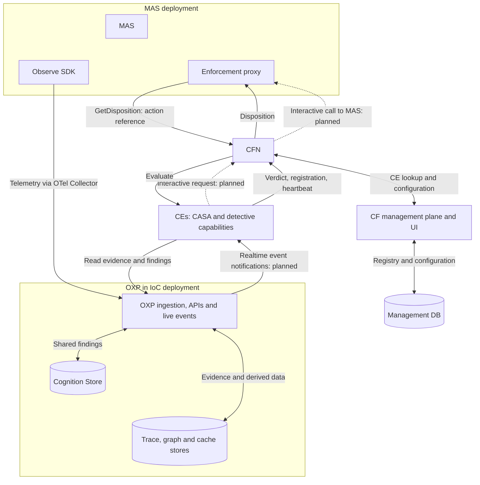

# Cognition Fabric architecture — Releases 1–3

<!-- kind: source · source of truth: GitHub (this file) -->

**Scope:** The first three releases of [IoC Scale](https://cisco-eti.atlassian.net/wiki/spaces/IST/pages/2923462749/Roadmap+Schedule+Milestones). This document describes the component boundaries, data flows, and current integration state. The roadmap owns release dates and detailed deliverables.

Curated architecture decisions, when needed, are recorded as [CFN service ADRs](decisions/README.md). The [longer-term target architecture](target-architecture.md) is separate from this release-scoped description.

## Overview

IoC adds observability and in-path guardrails to an existing multi-agent system (MAS) with limited changes to its agent logic. The Observe SDK sends MAS telemetry to OXP. An enforcement proxy holds a governed communication while Cognition Fabric Node (CFN) asks a Cognition Engine (CE) for a decision. The proxy then allows or blocks the action. When interactive CEs are implemented, the same proxy will also forward CE-initiated calls back into the MAS.

For Releases 1–3, OXP is deployed with the IoC stack. It contains the Cognition Store, serves telemetry and findings to CEs, and is intended to deliver realtime events directly to them. CFN manages CE integration and routes enforcement requests. CEs use OXP directly for evidence rather than querying it through CFN.

The release sequence advances from CASA in advisory mode to blocking enforcement and then detective capabilities. The current enforcement route selects one available CASA CE associated with the MAS. How additional CE types participate in routing and decisions remains to be defined.

## Simplified architecture



The MAS, proxy, and SDK are grouped as one deployment without implying a specific call interface among them. Dashed arrows show the planned interactive path from a CE through CFN and the proxy into the MAS; its request and response contract remains open. The OXP notification arrow is planned; its delivery contract and end-to-end operation remain open. The Cognition Store is shown separately from OXP's trace and graph stores because it holds CE findings and other cognitive context.

## Components and responsibilities

| Component | Responsibility in Releases 1–3 |
|---|---|
| **MAS and Observe SDK** | Run the agent application and emit traces and runtime events to OXP through the OTel Collector. |
| **Enforcement proxy** | Mediate MAS-originated governed communication, request a CFN disposition, and apply the allow/block outcome. Later, receive CE-initiated interactions from CFN, deliver them into the MAS, and return their responses. |
| **CFN** | Route enforcement to an associated, available CE and return its disposition to the proxy. The planned Interactive API also routes CE-initiated calls toward the MAS through the proxy. |
| **CF management plane** | Maintain workspaces, MAS and agent records, CE associations and configuration, and CE/CFN heartbeat status. Its management data is stored in PostgreSQL. |
| **OXP** | Ingest and process telemetry; serve traces, graph data and Cognition Store findings; deliver relevant live events to CEs. |
| **CEs** | Evaluate MAS activity and actions using OXP evidence. CASA handles authorization; detective capabilities are introduced during the release sequence. |

The shared Compose deployment contains CF, OXP, a demo CE, and an optional instrumented NOA sample MAS. The enforcement proxy is not yet wired into that Compose stack. For local development, the CFN repository contains a NOA source copy under `deploy/local/noa-trip-planner/`. It calls CFN directly before tool execution, and the source demo CE can return a configured ALLOW or DENY verdict. This demonstrates a held, blockable action through CFN and a CE without exercising the proxy or OXP evidence-readiness path.

CF management registers CEs and CFNs, receives their heartbeats, and stores MAS-to-CE associations. On an enforcement request, CFN looks up the MAS by `mas_id` and currently chooses the first associated, enabled, online CASA CE. Agent IDs are stored in management and forwarded to the CE; they do not currently select the CE. This routing behavior may evolve as more CE capabilities are integrated.

## CF source repositories

The CF services are maintained in four CF-owned source repositories:

| Repository | Responsibility |
|---|---|
| [ioc-scale-cfn-svc](https://github.com/cisco-eti/ioc-scale-cfn-svc) | CFN runtime: CE integration, enforcement API, and request routing. |
| [ioc-scale-cf-mgmt-svc](https://github.com/cisco-eti/ioc-scale-cf-mgmt-svc) | Management backend: workspaces, MAS and agent records, CE associations, configuration, and lifecycle status. |
| [ioc-scale-cf-ui](https://github.com/cisco-eti/ioc-scale-cf-ui) | Management UI for configuring and inspecting CF resources. |
| [ioc-scale-cf-demo-ce](https://github.com/cisco-eti/ioc-scale-cf-demo-ce) | Example CE implementing registration and evaluation; its local source can return a configured ALLOW or DENY verdict. |

The area-level [ioc-scale-cf-deployment](https://github.com/cisco-eti/ioc-scale-cf-deployment) repository assembles CF, OXP, and the optional published sample MAS in Compose and owns the shared database image. CF-specific local source workflows are in this repository under [`deploy/`](../deploy/README.md).

OXP source is maintained separately in [oxp-lib](https://github.com/cisco-eti/oxp-lib) and [oxp-ontology](https://github.com/cisco-eti/oxp-ontology). Those are OXP components, not additional CF services.

## Data and decision flows

### OXP evidence and live events

```text
Instrumented MAS → OTel Collector → ClickHouse raw spans
                                  → RabbitMQ / OXP workers → derived data in Neo4j
CE → OXP APIs → traces, graph data and Cognition Store findings
OXP live-event path → CE notifications (planned)
```

The planned live-event path forwards runtime events through the Collector as OTel logs and delivers relevant notifications to CEs. A CE can then query OXP for the related stored spans. Event subscription, filtering, delivery timing, and correlation with held actions remain open.

The Cognition Store holds shared findings and cognitive context within OXP. The demo CE uses OXP's `/api/v1/cognition-store/findings` endpoint to read prior findings and write its result. In the shared deployment, this findings API uses the `cognition_store` PostgreSQL database. The complete data model and write-access policy for other cognitive context remain open.

The NOA sample's reconstructed session data reaches Neo4j after a `session.end` span, which the SDK emits after an idle timeout or at process exit. A blocking decision therefore cannot assume that a completed session graph is already available.

### Blocking enforcement

```text
Proxy holds proposed action
  → CFN: GetDisposition(mas_id, agent IDs, trace_id, span_id, extra)
  → management lookup by mas_id
  → first associated, enabled, online CASA CE
  → CE: Evaluate(action reference and metadata)
  → CE reads needed evidence from OXP and returns verdict
  → CFN returns disposition
  → proxy allows or blocks the held action
```

`GetDisposition` carries identifiers and metadata, not the intercepted content. The action reference is `(trace_id, span_id)`. CFN forwards it to CASA, which retrieves the corresponding evidence from OXP. Application instrumentation must therefore publish the proposed action's destination and arguments before authorization; the normal tool-operation span may remain open until the held operation completes.

The Enforcing API carries proxy-originated decision requests toward CEs. The planned Interactive API carries CE-initiated calls through CFN and the proxy toward the MAS, with responses returning along that path. CEs read evidence from OXP directly in this release architecture. The interactive message contract and proxy behavior remain open.

The executable enforcement outcome is allow/block. The enforcement contract defaults to fail-closed, with explicit fail-open configuration for availability or timeout failures. A missing-context denial is distinct from a timeout. A production decision budget has not yet been defined; the proxy's two-second setting is a development default.

### Realtime events and completed spans

| | Realtime event | Completed span / batched trace data |
|---|---|---|
| **Availability** | Near emission, subject to export and delivery delay | After span end, export and ingestion |
| **Use** | Alert a CE quickly to activity it should inspect | Retrieve richer inputs, outputs and prior context |
| **Limit for enforcement** | The current live MCP message event omits request arguments and results | The normal tool-operation span may end only after the action the proxy is holding |

An argument-sensitive decision needs evidence before the action executes. ADR 0036 requires proposed-activity evidence before authorization; a separately completed proposed span is one option. That evidence must describe the exact held action, include the arguments CASA needs, become queryable within the decision budget, and remain bound to the action eventually released. Exporting a span does not by itself guarantee immediate queryability.

## Delivery state

| Area | Available now | Remaining integration |
|---|---|---|
| **Shared stack** | Compose deploys CF, OXP, a demo CE and an optional instrumented MAS. | Connect protected MAS traffic to the enforcement proxy. |
| **CFN routing** | gRPC contracts and selection of one associated CASA CE per MAS. The local NOA source can call CFN directly and block its own tool invocation. | Exercise the complete MAS → proxy → CFN → CASA → proxy path. |
| **OXP evidence** | Telemetry storage and processing, OXP APIs, and a findings endpoint. | Make complete proposed-action evidence queryable before the held action is released. |
| **Live notifications** | OXP → CE is the planned boundary. | Demonstrate subscriptions, delivery, correlation and adequate latency. |
| **Additional CE capabilities** | CASA is the first enforcement integration. | Define how detective CEs receive events, request action, and participate in CFN routing. |

## Terminology

| Term | Meaning here |
|---|---|
| **CASA** | Continuous Agent Semantic Authorization, the CE for authorization decisions. |
| **CE** | Cognition Engine, a service that analyzes MAS activity or evaluates a held action. |
| **CFN** | Cognition Fabric Node, which routes proxy enforcement requests to registered CEs. |
| **Cognition Store** | Shared findings and cognitive context contained within OXP for Releases 1–3. |
| **OXP** | The platform that processes telemetry and serves evidence to CEs. |
| **Activity reference** | The `(trace_id, span_id)` pair identifying a proposed protected action. |

## References

- [IoC Scale roadmap](https://cisco-eti.atlassian.net/wiki/spaces/IST/pages/2923462749/Roadmap+Schedule+Milestones)
- [CF management backend README](https://github.com/cisco-eti/ioc-scale-cf-mgmt-svc/blob/main/README.md)
- [CF management UI README](https://github.com/cisco-eti/ioc-scale-cf-ui/blob/main/README.md)
- [CFN repository README](https://github.com/cisco-eti/ioc-scale-cfn-svc/blob/main/README.md)
- [CFN enforcement handler](https://github.com/cisco-eti/ioc-scale-cfn-svc/blob/main/pkg/app/grpc_enforcement.go)
- [CFN enforcement protobuf](https://github.com/cisco-eti/ioc-scale-cfn-svc/blob/main/api/proto/enforcement/v1/enforcement.proto)
- [CE evaluation protobuf](https://github.com/cisco-eti/ioc-scale-cfn-svc/blob/main/api/proto/ce/v1/ce.proto)
- [Deployment README](https://github.com/cisco-eti/ioc-scale-cf-deployment/blob/main/README.md)
- [IoC Compose stack and optional NOA sample MAS](https://github.com/cisco-eti/ioc-scale-cf-deployment/blob/main/docker-compose.yml)
- [Demo CE OXP findings client](https://github.com/cisco-eti/ioc-scale-cf-demo-ce/blob/main/demo-ce/src/cognition_store.py)
- [ADR 0036 — CFN enforcement contract](https://cisco-eti.atlassian.net/wiki/spaces/IST/pages/3092807821/0036+CFN+enforcement+contract+evolution)
- [Enforcement contract and evidence requirements](https://cisco-eti.atlassian.net/wiki/spaces/IST/pages/3089530908/Spec+Enforcement+contract)
- [CASA CE requirements mapping](https://cisco-eti.atlassian.net/wiki/spaces/IST/pages/3084025895/CASA+CE+requirements+mapping)
- [GATs analytics and enforcement notes](https://cisco-eti.atlassian.net/wiki/spaces/Cognitive/pages/3032383512/Analytics+and+Enforcement+Architecture+for+GATs+Key+Points+and+Issues)
- [CE realtime event stream pipeline](https://cisco-eti.atlassian.net/wiki/spaces/IST/pages/2971664385/CE+realtime+event+stream+pipeline)
- [Proposed end-to-end PoC plan](https://cisco-eti.atlassian.net/wiki/spaces/Cognitive/pages/3151659063/Proposed+PoC+plan)
- [AGNTCY Observe SDK documentation](https://docs.agntcy.org/obs-and-eval/observe-and-eval/)
