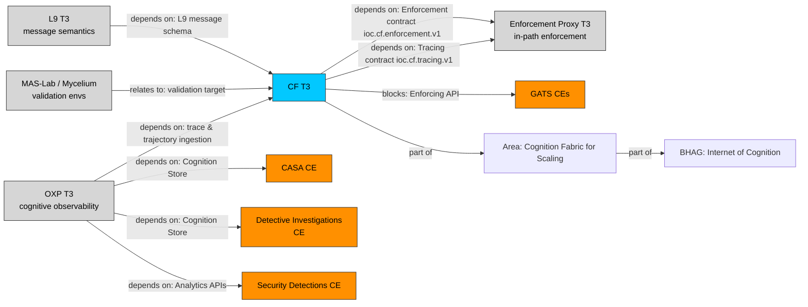

# Dependencies

<!-- kind: source+generated · source of truth: this file for project edges; Beads for roadmap/issue edges -->

What this T3 depends on, what depends on it, and where each relationship stands.

This file owns **project-level** relationships: T3-to-T3, T3-to-Area, T3-to-BHAG, and named
consumer dependencies. Roadmap and feature dependency graphs live in Beads and should be generated
from `.beads/issues.jsonl`; do not duplicate them by hand here.

## Relationship taxonomy

Every edge below uses one of these relations:

| Relation | Meaning |
|---|---|
| `blocks` | A cannot progress until B is done |
| `depends on` | A needs B's output or contract, but can progress in parallel on stubs |
| `supersedes` | A replaces B; B is retired |
| `duplicates` | A and B describe the same work |
| `contradicts` | A and B make incompatible claims; one must give |
| `relates to` | A and B share context but neither gates the other |
| `part of` | A is a component of B (T3 → Area → BHAG) |

## Dependency graph

Read the arrows as *"the tail is needed by / affects the head."* The Cognition Store
and Analytics APIs are currently owned by OXP. CEs depend directly on OXP for
findings and observability data; CF owns the Enforcing API contract.

**The Enforcement Proxy is our primary enforcement counterparty.** CF specifies the Enforcement
contract (`ioc.cf.enforcement.v1`) and Tracing contract (`ioc.cf.tracing.v1`); the Enforcement Proxy
executes enforcement in-path.

## Project-level dependencies

| # | Relation | Owner (their side) | Owner (ours) | Target date | Progress |
|---|---|---|---|---|---|
| P1 | **CF `depends on` L9** for message and interaction semantics | L9 main protocol & CEs T3 | TBD | Ongoing | **At risk** — L9 schema still evolving; CF mediates without owning it |
| P2 | **CF `depends on` OXP** for **trajectories and cognitive enrichment** — OXP is the primary source of traces and reconstructed trajectories | OXP T3 | TBD | TBD | **Not started** — integration design not yet captured |
| P3 | **Enforcement Proxy `depends on` CF** for the **Enforcement contract** `ioc.cf.enforcement.v1` — CF specifies, Proxy executes | Enforcement Proxy T3 | TBD | TBD | **Not started** — contract specification in progress |
| P4 | **Enforcement Proxy `depends on` CF** for the **Tracing contract** `ioc.cf.tracing.v1` | Enforcement Proxy T3 | TBD | TBD | **Not started** — contract not yet written |
| P5 | **CASA `depends on` OXP** — needs the OXP-owned Cognition Store to publish and consume findings | CASA CE T3 | TBD | TBD | **Not started** |
| P6 | **Detective Investigations `depends on` OXP** — needs the Cognition Store for findings; CF CE chaining is planned separately | Detective Active Investigations CE T3 | TBD | TBD | **Not started** |
| P7 | **GATS CEs `blocks on` CF** — needs the Enforcing API to issue dispositions | GATS CEs T3 | TBD | TBD | **Not started** |
| P8 | **Security Detections `depends on` OXP** — consumes OXP's Analytics APIs directly; not gated on CF | Security Detections CE T3 | TBD | — | **Not started** |
| P9 | **CF `relates to` MAS-Lab and Mycelium** as validation environments | MAS-Lab T3 / Mycelium T3 | TBD | — | **Open** — target environment undecided |
| P10 | **CF `part of` Cognition Fabric for Scaling**, which is `part of` the IoC BHAG | Area Context Leads | Darren Lau | — | **Done** — positioning settled in charter |

## Upstream dependencies

| Service | Purpose | Contract |
|---------|---------|----------|
| `OXP` | Traces, trajectories, cognitive enrichment and Cognition Store findings | OXP Analytics and Cognition Store interfaces |
| `L9` | Message and interaction semantics | L9 protocol |

## Downstream dependencies

| Consumer | Purpose | Contract |
|----------|---------|----------|
| `Enforcement Proxy` | In-path enforcement execution | `ioc.cf.enforcement.v1`, `ioc.cf.tracing.v1` |
| Multi-Agent Systems (MAS) | Consumers of CF runtime decisions | Enforcing gRPC; Active APIs planned |
| CASA CE | Enforcement evaluation; publish/consume findings through OXP | CE gRPC; OXP Cognition Store interfaces |
| Detective Investigations CE | Findings access; planned Active APIs and CE chaining | OXP Cognition Store interfaces; planned CF APIs |
| GATS CEs | Enforcing tier dispositions | Enforcing API |
| Security Detections CE | Direct OXP Analytics queries | OXP Analytics APIs |
