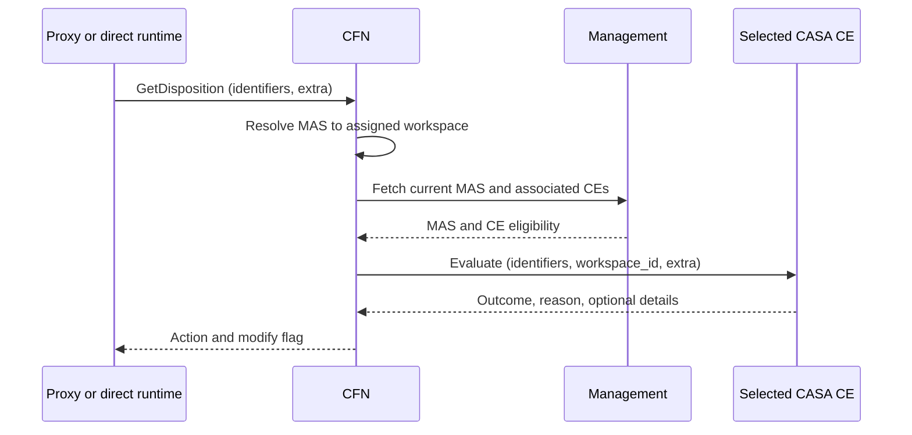

# D1 — Enforcement API Contract

**Status:** Implemented

**Date:** 2026-10-02 (updated from 2026-08-21)

**Parties:** CF T3, Enforcement Proxy T3

## Context

The Enforcement Proxy needs to call CF to determine the disposition for in-flight L9 interactions.
This discussion captures the initial agreement on the API shape between the two teams.

## Current agreement

**Contract:** `ioc.cf.enforcement.v1.Enforcement`

**RPC:** `GetDisposition`

**Protocol:** gRPC/Proto (preferred over REST for consistency between teams)

**Behavior:**
- Blocking — the Enforcement Proxy blocks until CF returns a disposition
- Timeout — currently 30 seconds per Management HTTP attempt, CE connection and CE
  `Evaluate`, bounded by any earlier caller deadline. Management HTTP retries can
  extend the total elapsed time; these are not a single 30-second end-to-end limit.
  The agreed contract timeout remains open.

### Request (`GetDispositionRequest`)

```bash
grpcurl -plaintext -emit-defaults -d '{
  "extra": { "key": "value" },
  "payload": {
    "mas_id": "550e8400-e29b-41d4-a716-446655440000",
    "source_agent_id": "agent-1",
    "destination_agent_id": "agent-2",
    "trace_id": "trace-123",
    "span_id": "span-456"
  }
}' localhost:9003 ioc.cf.enforcement.v1.Enforcement/GetDisposition
```

**Notes:**
- `workspace_id` is **not** exposed to the Enforcement Proxy — CF/management-plane handles workspace resolution internally (see decision D1.1 below)
- `trace_id` — Proxy needs to observe this ID to coordinate spans; sync with Pavan
- `span_id` — Identifies the specific operation within the trace for precise correlation
- `extra` — map of string key-value pairs for headers/metadata (contents TBD)

CFN populates only these identifiers, the resolved `workspace_id` and `extra` in
the CE `EvaluateRequest`. Evidence lookup and policy evaluation belong to the CE;
CFN does not assemble OXP context or call an Active API fallback.

### Response (`GetDispositionResponse`)

```json
{
  "action": "ACTION_ALLOW",
  "modify": false
}
```

**Current actions:**
- `allow` — permit the interaction to proceed unchanged
- `block` — deny the interaction
- `unspecified` — if the CE RPC succeeds with `DECISION_UNSPECIFIED` or an
  unrecognized outcome, CFN returns `ACTION_UNSPECIFIED`, `modify=false` and gRPC
  `OK`. The caller decides whether to fail closed; the local NOA direct caller
  blocks execution. CE connection or RPC failures instead return gRPC errors.

CFN also maps a CE `DECISION_MODIFY` to `ACTION_MODIFY` with `modify=true`, but the
response has no replacement-content field. This signals a requested modification;
it does not implement rewriting. CFN does not emit `ACTION_INJECT`. End-to-end
modification and injection remain deferred, despite the reserved proto values.

### Current enforcement flow



CFN selects the first associated CASA CE that is enabled, online and has an
enforcing address. It does not fan out or chain evaluations. CE details are captured
in the CFN audit when valid and within its budget, not returned to the caller.
The caller owns applying the disposition; CE policy internals and actual Proxy
forwarding are outside this CF flow. The separate
[`AppendAuditRecord`](../../api/enforcement/docs/proxy-audit-ingestion.md) RPC records Proxy evidence.

## Decisions

### D1.1 — Hide workspace from Enforcement Proxy

**Decision:** The `workspace_id` concept is abstracted away from the Enforcement Proxy client. The proxy only provides `mas_id`; CF/management-plane is responsible for resolving the associated workspace internally.

**Rationale:**
- `mas_id` is sufficient for tenancy requirement for now
- Simplifies the Enforcement Proxy contract — fewer concepts to understand and propagate
- Workspace is a CF/management-plane concern, not an enforcement concern

**Implication:** CF must maintain a `mas_id → workspace_id` mapping and perform the lookup on each enforcement request.

## Open questions

| Item | Status | Owner |
|------|--------|-------|
| `extra` field contents — what headers/metadata are needed? | TBD | CF + Proxy |
| Final end-to-end timeout agreement — current per-operation limits described above | TBD | CF + CASA |
| `modify` action semantics — what can be modified and how? | TBD | CF + Proxy |
| `mas_id` semantics — needs IOC-level agreement | TBD | IOC |
| `trace_id` format and coordination — sync with Pavan | TBD | CF + Proxy |
| Request payload and response — to be determined by L9 request spec | TBD | L9 |
