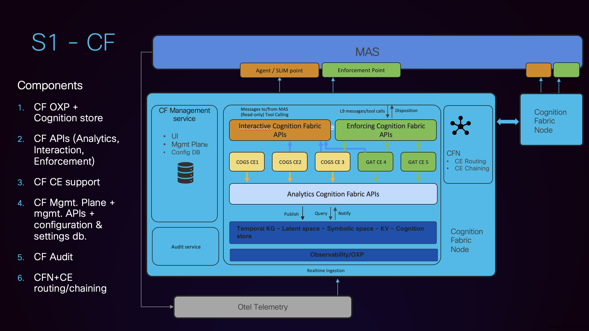

# Longer-term target architecture

This document describes the broader CF target and planned API surface. See
[architecture.md](architecture.md) for the current implementation.

<!-- kind: source · source of truth: GitHub (this file) -->

## High-level architecture

In the historical concept diagram, OXP refers to the **System for Cognitive
Observability, Provenance and Explainability (SCOPE)**. CF owns two API tiers,
Active (planned) and Enforcing. SCOPE owns the Analytics APIs and Cognition Store,
which CEs access directly.

## Components

### 1. SCOPE and the Cognition Store

SCOPE owns the Cognition Store and provides the data layer for CEs.

- **Temporal KG** — temporal knowledge graph
- **Latent space** — vector embeddings
- **Symbolic space** — symbolic representations
- **KV** — key-value storage
- **Cognition** — cognitive state

SCOPE ingests OpenTelemetry data in real time to populate the Cognition Store.

### 2. CF APIs (Active, Enforcing) and SCOPE Analytics APIs

CF owns two API tiers:

| Tier | APIs | Purpose |
|------|------|---------|
| **Active** | Active Cognition Fabric APIs (planned) | Direct MAS engagement — CEs send messages, query tools |
| **Enforcing** | Enforcing Cognition Fabric APIs | Enforcement decisions; content modification and injection remain target capabilities |

Analytics APIs are owned and served directly by SCOPE. CEs query SCOPE for traces,
trajectories, metrics and Cognition Store findings.

- **Active Cognition Fabric APIs** (labelled Interactive in the historical diagram) receiving messages to/from MAS and tool calling
- **Enforcing Cognition Fabric APIs** handling L9 messages/tool calls with disposition
- **SCOPE Analytics APIs** providing read access to the Cognition Store

### 3. CF CE Support

Cognition Engines connect to the APIs:
- **COGS CE1, CE2, CE3** — planned consumers of Active APIs
- **GAT CE 4, GAT CE 5** — connected to Enforcing APIs

### 4. CF Mgmt. Plane + mgmt. APIs + configuration & settings db.

The **CF Management service** provides:
- UI
- Mgmt Plane
- Config DB

### 5. CF Audit

**Audit service** for compliance and observability.

### 6. CFN + CE routing/chaining

The **Cognition Fabric Node (CFN)** handles:
- CE Routing
- CE Chaining

## Data flow

### MAS to CF

1. **Agent / SLIM point** — MAS agents connect via SLIM or direct agent protocols
2. **Enforcement Point** — in-path enforcement via the Enforcement Proxy
3. Planned Active APIs support direct MAS engagement; Enforcing APIs support enforcement decisions

### CE to SCOPE and the Cognition Store

1. CEs publish and query findings through the SCOPE-owned Cognition Store interfaces
2. SCOPE owns trace ingestion, trajectory reconstruction and Analytics APIs
3. OpenTelemetry data flows into SCOPE, and CEs call its Analytics APIs directly

Notification requirements remain subject to the SCOPE/CE contract.

### CE interactions

1. COGS CEs are planned consumers of Active APIs for direct MAS engagement
2. GAT CEs connect to Enforcing APIs to issue dispositions
3. CEs query SCOPE's Analytics APIs directly for read-only access

## Key contracts

| Contract | From | To | Protocol | Purpose | Status |
|----------|------|-----|----------|---------|--------|
| `ioc.cf.enforcement.v1` | CF | Enforcement Proxy | gRPC/Proto | Enforcement contract — dispositions (`allow`/`block`/`modify`) | [Under discussion](discussions/0001-enforcement-api-contract.md) |
| `ioc.cf.tracing.v1` | CF | Enforcement Proxy | TBD | Tracing contract — correlated traces | Not started |
| L9 message schema | L9 T3 | CF | — | Message and interaction semantics | Dependent on L9 T3 |

## Deployment

CF deploys as a set of microservices:
- **CF Management service** — management plane, UI, config
- **Cognition Fabric Node** — API gateway, CE routing
- **Audit service** — compliance logging

The Cognition Store and Analytics APIs belong to SCOPE, which runs alongside the
CF services in the [standard CF deployment](architecture.md#purpose-and-boundary).

## Related documents

- [Charter](charter.md) — problem statement, scope, goals
- [Dependencies](dependencies.md) — project-level relationships
- [Decisions](decisions/README.md) — Architecture Decision Records
- [Specs](specs/README.md) — detailed specifications
