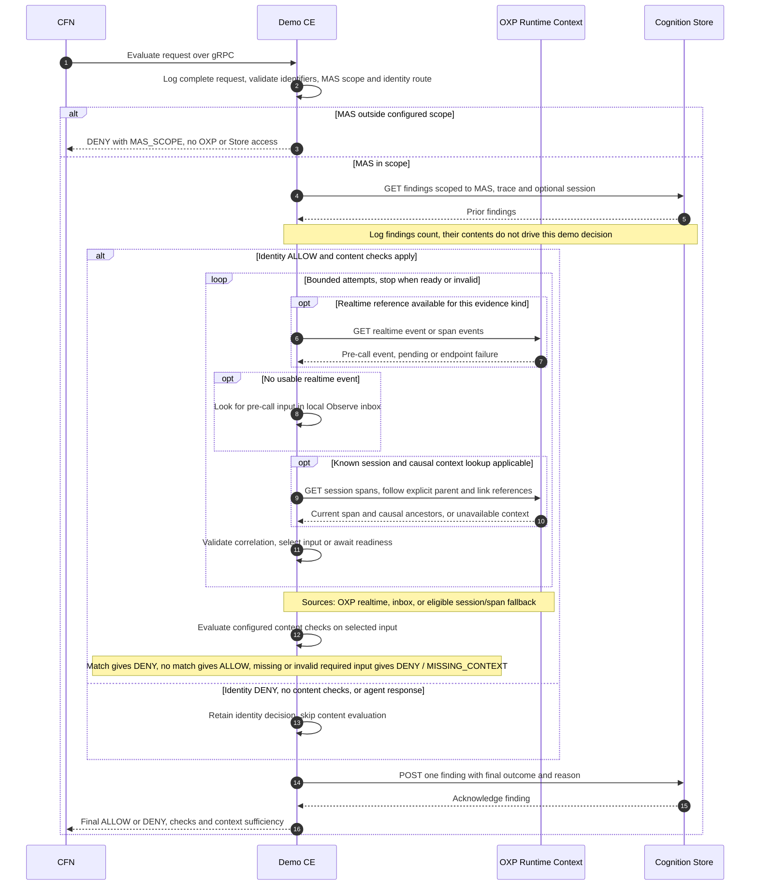

# Demo CE

A demonstration Cognition Engine (`ioc.ce.v1.CognitionEngine`) for the IOC platform. It is agnostic of any
application: it loads identity and content rules per MAS from a JSON file and answers `Evaluate` from them.
The JSON config supplies the demo rules.

CFN calls the CE over gRPC (`:18001`, `ce.v1`, the contract comes from the local `github.com/cisco-eti/cognition-fabric/api` Go module).
The CE registers itself with CFN over REST (`POST /api/cognition-engine`, conflict recovery by `PATCH`),
attempting registration immediately and retrying once per second until it succeeds. It declares a
`health_url` (its `GET /healthz`) and a `notification_url` on the same HTTP listener (`POST /notification`).
After register or PATCH it pulls currently associated MAS IDs from CFN, then stays current from
lifecycle notifications. CFN probes health every couple of seconds to decide whether the CE is online,
so the CE sends no heartbeats. Associated MAS state is for lifecycle logging only; it is not a policy source.

See the [documentation site source](../docs-site/README.md) for the full Demo CE guide.

## Evaluation response

The common response is `outcome`, free-text `reason` and the existing metadata.
Demo diagnostics now live in `details` with `schema: demo-ce.v1`, `checks_run`
(check ID, passed flag and reason), and supplied denial/context diagnostics. The
four deprecated top-level diagnostics are omitted. Policy evaluation, evidence,
findings and logs retain their previous behavior. Existing consumers still decode
outcome/reason; unchanged real CEs can keep using their existing bindings.
See the [shared response contract](../../api/ce/docs/ce-evaluation-response.md).

The frozen descriptor under `internal/engine/testdata/` must remain independent
of current generation.

## Stack and repositories

The Demo CE calls **CFN** for registration and is called by CFN for evaluation.
It calls the **OXP API** for runtime context and Cognition Store findings. The other components
below provide the onboarding, application traffic, telemetry and enforcement shown in the NOA demo.

| Component | Repository / source | Role in the demo |
|---|---|---|
| Demo CE | [ioc-scale-cf-demo-ce / demo-ce](.) | Loads `config.json`, evaluates requests and persists final findings |
| CFN service and CE contract | [ioc-scale-cfn-svc](../../cfn) | Registers CEs and invokes `ioc.ce.v1.CognitionEngine.Evaluate` over gRPC |
| OXP runtime context API | [ioc-scaling-oxp](https://github.com/cisco-eti/ioc-scaling-oxp), [API source](https://github.com/cisco-eti/ioc-scaling-oxp/tree/main/ioc-analytics-api/api) | Serves realtime events and session spans used to resolve the current input and causal context |
| Cognition Store API | [cognition_store.py](https://github.com/cisco-eti/ioc-scaling-oxp/blob/main/ioc-analytics-api/api/oxp/api/api_v1/endpoints/cognition_store.py) in the same OXP repository | Reads prior findings and accepts the final ALLOW/DENY finding; it is not a separate CE |
| Observe SDK | [agntcy/observe](https://github.com/agntcy/observe) | Instruments the MAS and publishes runtime events for OXP and the CE inbox |
| Enforcement proxy | [ioc-scaling-enforcement-proxy](https://github.com/cisco-eti/ioc-scaling-enforcement-proxy) | Envoy integration and mediation of A2A/MCP/LLM calls through CFN |
| NOA demo orchestration | [ioc-scaling-demos / noa](https://github.com/cisco-eti/ioc-scaling-demos/tree/main/noa) | Runs the demo with Compose and selects the enforcement adapter |
| NOA application sources | [oxp-sample-apps](https://github.com/cisco-eti/oxp-sample-apps) | Source repository for the NOA trip-planner applications used by the demo |
| CF management API | [ioc-scale-cf-mgmt-svc](../../cf-mgmt) | Management API behind manual MAS onboarding and CE association |
| CFN UI | [ioc-scale-cf-ui](../../cf-ui) | Onboards the MAS and associates its Demo CE |
| Shared platform deployment | [ioc-scale-cf-deployment](https://github.com/cisco-eti/ioc-scale-cf-deployment) | Platform Compose configuration and supporting databases, brokers, collectors and OXP workers |

Start with the [NOA demo instructions](https://github.com/cisco-eti/ioc-scaling-demos/tree/main/noa)
for the full stack. This repository's root [docker-compose.yml](../docker-compose.yml) starts only the Demo CE
and expects CFN and OXP to be reachable through `CFN_URL` and `OXP_API_URL`.
The supporting infrastructure (PostgreSQL, ClickHouse, Neo4j, Redis, RabbitMQ and the OpenTelemetry Collector)
is wired in the platform/demo Compose files; the CE accesses it through the CFN and OXP APIs.

## Demo evaluation flow

Follow one request through this diagram while watching the [demo logs](#demo-logs).
It shows the Compose setup with `OXP_API_URL` configured. The Demo CE loads its identity
and content rules from `config.json` at startup.



### Narration for the recording

1. **Receive and scope:** CFN sends the complete request. Show `evaluation.start`, then
   `identity.complete` to identify the MAS, caller, destination and configured route.
2. **Read findings:** show `store.read.complete` and the findings count. The CE checks Store
   availability and response shape; it does not use prior finding contents to decide.
3. **Resolve the current input:** show `oxp.realtime.*`, `oxp.context.*` and `evidence.selected`.
   OXP supplies pre-call events and causal context; Observe can also supply pre-call input to the local inbox.
   Earlier activities are context, not the input being checked. A pending referenced A2A/MCP event
   is awaited rather than replaced by the span's own input. Invalid correlation is denied immediately.
4. **Explain the decision:** show `content.complete` and the matching rule, or `content.skipped`.
   Optional history can be absent without blocking valid pre-call input. Required input or tool
   definitions must be available within the retry budget. Span fallback and OXP-sourced tool definitions
   report `DEGRADED_ATOMIC` because OXP does not confirm their trace identity.
5. **Persist and return:** show `store.write.complete` before `evaluation.complete`.
   Only the final finding is persisted, including a content or missing-context DENY.

**Failure paths:** invalid request identifiers return gRPC `InvalidArgument`; an unresolved local
MAS identity returns `Unavailable`. A Store read or write failure interrupts the normal path above:
`evaluation.failed` reports a gRPC error instead of returning a successful evaluation. Cancellation
and deadlines retain their gRPC status. No content check or finding write follows a failed Store read.

## Layout

```
demo-ce/
├── cmd/demo-ce/              # main: configuration from env, HTTP and gRPC servers
├── pkg/config/              # config file schema and decoder (public, reusable to validate a config.json)
├── internal/engine/          # CognitionEngine: router per MAS, then identity, then content
│   ├── identity/             # identity layer: route decision and MAS scope
│   └── evidence/             # Judge: what a content rule is judged against, one package per kind
│       ├── correlation/      #   pre-call input joined with OXP parent/link context
│       ├── llm/              #   llm_input: model request published before the call
│       ├── mcp/              #   mcp_tool_input: MCP tools/call arguments published before the call
│       ├── a2a/              #   a2a_message_input: A2A message text published before the call
│       └── events/           #   the inbox judge and event parsing shared by llm, mcp and a2a
├── internal/inbox/           # Observe event inbox (POST /events), found again by trace and span
├── internal/cfn/             # registration and conflict recovery with CFN (REST)
├── internal/oxp/             # OXP Cognition Store and session spans client
├── internal/httpjson/        # JSON-over-HTTP exchange shared by the clients
├── internal/logging/         # colored console / JSON logs and request correlation
├── internal/ids/             # trace/span id validation
└── config/                   # config.json: a config file for two MAS (mounted by the compose service)
```

## Config file

`CE_CONFIG_FILE` (default `/etc/demo-ce/config.json`) is one of:

- **Per MAS** (several allowed): `{"mas": [{"mas_id": "...", "rules": [...], "content_rules": [...]}, ...]}`.
  A request for a MAS that is not listed is denied (`MAS_SCOPE`) without touching its Cognition Store scope.
  See [config/config.json](config/config.json).
- **Single config**: `{"rules": [...], "content_rules": [...]}`, bound to the MAS id that `CE_MAS_FILE`
  (default `/var/lib/demo-ce/mas-id`) holds, for setups where a bootstrap writes it after registration.
  ```json
  {"rules": [{"id": "A", "effect": "ALLOW", "reason": "...", "sources": ["x"], "destinations": ["y"]}],
   "content_rules": []}
  ```

Identity rules need a unique `id`, an `ALLOW`/`DENY` effect, a `reason` and literal `sources`/`destinations`.
DENY overrides ALLOW and an unmatched route is denied. Content rules apply after identity allows a route.
Each rule has one `evidence`: `tool_input` (default), `a2a_message_input`, `llm_input` or `mcp_tool_input`.
These select the input shape. Every kind uses the same correlation flow; there is no evidence profile selector.

The engine fetches prior Cognition Store findings after validating MAS scope. Their contents are not
currently used in the decision: the read validates Store availability and the findings response.
The engine then evaluates content and writes
one finding with the final outcome and reason. Content and missing-context denials are persisted as DENY,
without an earlier identity ALLOW finding. Foreign MAS requests never access the Store. Reads and writes
each have a 1s timeout; Store failures remain fail-closed.

## Pre-call event by id (OXP realtime)

When `OXP_API_URL` is set, the CE reads the pre-call content from the OXP realtime endpoints before looking
in the inbox.

**`a2a_message_input` and `mcp_tool_input`**, from the request's `extra`:

`ioc.observe.event_id` is the `event.id` of the carrier, always the id of the `*.message.sent` event:
`GET /api/v1/realtime/events/{id}`. With Observe SDK >= 1.0.57 this event carries the content: the text
`parts` of an A2A message (`data.input.messageId` must match `ioc.observe.message_id`) or the `arguments` of
an MCP `tools/call`. If it carries none (SDK <= 1.0.56),
`GET /api/v1/realtime/spans/{span_id}/events?event_types=tool.started` and the one `tool.started` whose
`correlation.parent_event_id` equals it. The SDK 1.0.58 A2A carrier also holds the `tool.started` id in
`metadata.observe["tool.event.id"]` and the MCP carrier none; the CE does not use them, and an
`ioc.observe.precall_event_id` in the `extra` is ignored.

`tool_input` uses only the `tool.started` child.

**`llm_input`** needs no id: `GET /api/v1/realtime/spans/{span_id}/events?event_types=llm.started`. A span has
one `llm.started`, whose `data.input` is the prompt, and the trace must be the request's. No event leaves the
request to the inbox and the span fallback; more than one is ambiguous and is `DENY / MISSING_CONTEXT`
(`GAP`), never a pick.

The referenced event must be of the request's exact trace (the `tool.started` also of its exact span), of the
expected type; anything else, or ambiguous children, is `DENY / MISSING_CONTEXT` (`GAP`). For
`a2a_message_input` and `mcp_tool_input`, a 404 or a missing child means "not ingested yet": retried within
`CE_CONTEXT_WAIT` and `CE_CONTEXT_ATTEMPTS`, ending in `RACE`, without borrowing the span's own input. If
the endpoints fail (network, 5xx, malformed answer), the CE behaves as without them: inbox first, then the
OXP span fallback. A decision from this path adds the check `OXP_REALTIME_EVENT`.

## Input and causal context

1. Look for `tool.started` or `llm.started` in the inbox by the request's exact `trace_id` and `span_id`.
   Observe must publish these events **before sending** the intercepted request. The SDK's pre-call
   recording emits runtime events; it does not make an unfinished span queryable in OXP.
2. Use the event's session to fetch `GET /api/v1/sessions/{session_id}/spans`, following declared
   `parent_span_id` and span links. The OXP session key follows its materialized column: remove everything
   through the first underscore from the native `application_UUID` session ID. Event/session comparisons
   retain the full native ID; a returned `session.id` attribute must match it.
   Earlier siblings, timestamps and destination names are never used
   to guess which activity owns the input.
3. Judge the current input immediately when it is available. Optional history has a 1s timeout, bounded by the shared decision budget and caller deadline;
   its absence is reported by
   `OXP_CAUSAL_CONTEXT` with `passed=false` and does not block a valid pre-call input.
4. If no pre-call event exists, use the selected OXP session/span's own input when available.
   The lookup keeps pagination progress while checking for newly arriving events; a pre-call event
   takes priority. All reads and readiness retries share `CE_CONTEXT_WAIT` and the caller deadline.
   `CE_CONTEXT_ATTEMPTS` caps resolution attempts, including the initial attempt;
   `CE_CONTEXT_RETRY_WAIT` separates failed attempts. Newly arriving pre-call events interrupt
   that interval. Invalid correlation fails immediately; optional history is not retried when
   the current pre-call input is already sufficient. Pagination belongs to one lookup attempt.

The AGNTCY Observe SDK must send normalized runtime events to `POST /events` on the CE HTTP port.
`CE_EVENT_SERVICE` can restrict the accepted `service_name`. OXP is optional for event-only decisions;
set `OXP_API_URL` to enable causal history, span-input fallback and the Cognition Store.

Content regexes inspect **only the current call's input**. Parents and links establish structural context;
their contents do not become the current call's arguments. Malformed messages, conflicting pre-call inputs,
wrong sessions and ambiguous ancestry cannot become an empty successful content check. Missing required
input returns `DENY / MISSING_CONTEXT` (`RACE` on readiness timeout, `GAP` on invalid correlation).

For `llm_input`, `roles` selects `system`, `developer`, `user`, `assistant`, `tool`, `tool_call` or
`tool_definition`. The default is user, assistant, tool and tool_call. GenAI message events do not contain
separate tool definitions: rules requiring them wait for `gen_ai.tool.definitions` on the selected OXP span.
An explicitly empty definitions list is known; an absent list is missing required evidence. Agent responses
remain identity-only, and routes without content rules retain their identity decision.

### Binding and OXP readiness limits

A pre-call event binds its input by exact trace/span and reports `COMPLETE` for rules whose required
input is in that event. OXP's current `SpanMetadataItem` exposes `span_id` and `session_id`, but **not its
own `trace_id`**. Span-only decisions, or decisions requiring definitions borrowed from OXP, therefore
report `DEGRADED_ATOMIC`; the CE cannot confirm the submitted trace or link target trace identities from
that endpoint. `OXP_CAUSAL_CONTEXT` reports this scope even when the structural lookup succeeds.

The client reads at most 5,000 spans, 8 MiB and 128 ancestry levels, with pages of 500. Referenced parents
or links outside the returned session remain pending. The endpoint provides no snapshot token, so a
session changing between pages can produce duplicates; duplicates are rejected rather than guessed.

OXP's server-side session cache does not honor the client's `Cache-Control: no-cache`. For readiness
within the decision hold budget, configure the OXP deployment with `CACHE_ENABLED=false`, or qualify
its cache TTL and ingest latency against that budget. The CE does not change OXP configuration. These
paths are covered with HTTP contract tests. Qualify OXP ingestion timing against the hold budget in each deployment.

### Config format migration

The old profile and tool-prefix environment selectors have been removed and are no longer read.
A config containing `evidence_by_profile` fails validation as an unknown field. Replace
that map with a single `evidence` for the route (`a2a_message_input`, `llm_input`, `mcp_tool_input`, or
`tool_input` for a decorated tool). Keep all required rules in `content_rules`. The bundled NOA fixture
shows the migrated seven-rule config without changing its rule patterns.

## Configuration

| Variable | Default | |
|---|---|---|
| `CFN_URL` | `http://ioc-scale-cfn-svc:9002` | CFN base URL (REST, registration) |
| `OXP_API_URL` | empty | OXP base URL (session spans and Cognition Store); optional for pre-call input decisions |
| `ADVERTISED_GRPC_ADDRESS` | `demo-ce:18001` | address CFN uses to call this CE |
| `ADVERTISED_HEALTH_URL` | `http://<host of ADVERTISED_GRPC_ADDRESS>:<port of HTTP_LISTEN_ADDRESS>` | Base URL CFN probes (`health_url` at registration; CFN appends `/healthz`). Set it when CFN reaches the HTTP port under another host or port. Do not include the path |
| `ADVERTISED_NOTIFICATION_URL` | Same as `ADVERTISED_HEALTH_URL` when that is set, otherwise the derived health base URL | Base URL for `notification_url` at registration (CFN appends `/notification`). Defaults to the health override so CFN can reach both callbacks in the same NAT/port-map setup. Do not include the path |
| `GRPC_LISTEN_ADDRESS` / `HTTP_LISTEN_ADDRESS` | `:18001` / `:18000` | |
| `CE_NAME` / `CE_VERSION` | `demo-ce` / `1.0.0` | registration metadata |
| `CE_CONFIG_FILE` / `CE_MAS_FILE` | see above | |
| `CE_EVENT_SERVICE` | empty (any) | only accept events from this `service_name` |
| `CE_CONTEXT_WAIT` | `1s` | shared content/context wait budget, at most `25s` |
| `CE_CONTEXT_ATTEMPTS` | `5` | maximum resolution attempts, including the initial attempt |
| `CE_CONTEXT_RETRY_WAIT` | `0.2s` | interval between failed attempts, bounded by the shared budget and caller deadline |

With fast OXP responses, the defaults allow attempts around 0s, 0.2s, 0.4s, 0.6s and 0.8s.
Request latency consumes the same 1s budget, so fewer attempts may run. Success stops the
retry loop; exhaustion returns `DENY / MISSING_CONTEXT`. HTTP requests still have a 1s timeout.

Health: `/healthz`, `/readyz` (ready once registered), `/info`.

## Demo logs

Logs use Go `slog` with `tint`. The default console format colors stages in cyan,
ALLOW outcomes in green and DENY outcomes in red; warnings and errors have distinct levels.
Colors stay enabled through Compose for the demo recording.

```bash
docker compose up --build -d
docker compose logs -f --no-log-prefix demo-ce
```

Each evaluation starts with `evaluation.start`, including the **complete CFN Evaluate request**
in protobuf JSON (`request`), including `extra`, nested fields and default values.
This is the decoded gRPC message, not HTTP headers or raw transport bytes.
`trace_id`, `span_id`, MAS and caller/destination fields correlate the subsequent steps:

1. `identity.complete`: configured route and MAS scope evaluated.
2. `store.read.start` / `store.read.complete`: prior findings fetched, with `findings_count`.
   `history_used_for_decision=false` makes clear that their contents do not drive this demo's decision.
3. `oxp.realtime.*` / `oxp.context.*`: pre-call event and causal parent/link lookups,
   availability, ancestor count and duration. `context.retry` explains readiness retries.
4. `evidence.selected`: the input actually used (`oxp_realtime`, `inbox` or `oxp_span_fallback`),
   including whether its trace identity was confirmed. A successful lookup alone does not imply valid evidence.
5. `content.complete`: outcome and matching content rule; `content.skipped` explains identity-only paths.
6. `store.write.complete`: the final finding has been acknowledged by the Cognition Store.
7. `evaluation.complete`: final ALLOW/DENY and context sufficiency, followed by check results.
   `evaluation.failed` reports a gRPC failure instead of a successful decision when Store persistence fails.

Out-of-scope MAS requests skip OXP and Store access. With OXP disabled, `store.skipped` explains
that findings are neither read nor persisted. Logs do not include OXP response payloads or findings contents;
the complete incoming CFN request is logged as requested for the demo.

| Variable | Default | Purpose |
|---|---|---|
| `LOG_FORMAT` | `console` | Colored readable output, or `json` for structured collection |
| `LOG_LEVEL` | `info` | `debug`, `info`, `warn` or `error` |
| `NO_COLOR` | empty | Any non-empty value disables console colors |

To inspect the complete CFN request as formatted JSON:

```bash
LOG_FORMAT=json docker compose up -d --force-recreate demo-ce
docker compose logs -f --no-log-prefix demo-ce | jq 'select(.event == "evaluation.start") | .request'
```

## Build and test

The CE imports the local API module through the root Go workspace and a local
`replace` directive in [go.mod](go.mod). No private-module credential is needed.
From the monorepo root:

```bash
go -C samples/demo-ce test -race ./...
GOWORK=off go -C samples/demo-ce build ./...
docker build -f samples/demo-ce/Dockerfile -t demo-ce:dev .
```

The root `task test` and `task check` aggregates also cover this CE. Use the
[local stack guide](../../dev/README.md) for source/image runs and the
[release guide](../../docs/releases.md) for folder-prefixed component tags.
