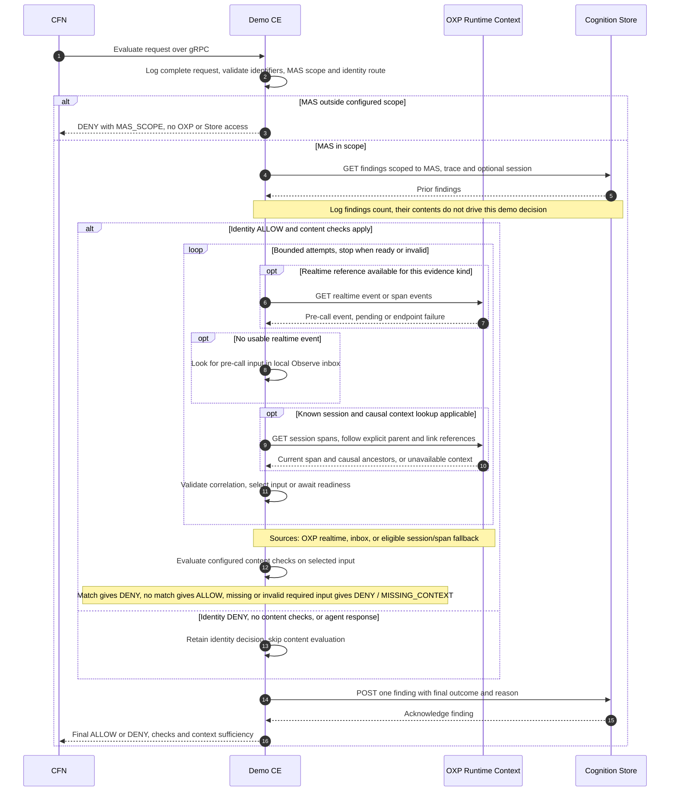

Follow one request through this diagram while watching the [demo logs](logs.md).
It shows the Compose setup with `OXP_API_URL` configured. The Demo CE loads its identity
and content rules from `config.json` at startup.

## Input selection and failure paths

The CE first attempts an eligible realtime lookup, then checks its local inbox if there is no usable
realtime event. It can use the selected OXP session/span input as fallback where the reference allows it.
Pre-call evidence has priority over span fallback, including evidence arriving while a lookup is in flight.
A pending referenced A2A/MCP carrier is awaited, rather than replaced by the span's input.

| Situation | Result |
|---|---|
| Foreign MAS | DENY with `MAS_SCOPE`, without OXP or Store access |
| Invalid required identifiers | gRPC `InvalidArgument` |
| Local MAS ID cannot be resolved | gRPC `Unavailable` |
| Content rule matches selected input | DENY, naming the matched rule |
| Required evidence is invalid or contradicts correlation | DENY / `MISSING_CONTEXT`, cause `GAP` |
| Required evidence is still missing after the readiness budget | DENY / `MISSING_CONTEXT`, cause `RACE` |
| Store read/write fails | gRPC error, without a successful evaluation response |

Optional OXP history can be unavailable without blocking valid pre-call input. Invalid history correlation
is rejected. Model rules requiring tool definitions must obtain those definitions before deciding.
OXP session/span metadata cannot confirm trace identity, so span fallback or OXP-sourced definitions
report `DEGRADED_ATOMIC`. See the [log events](logs.md) for the evidence source used on an actual request.
