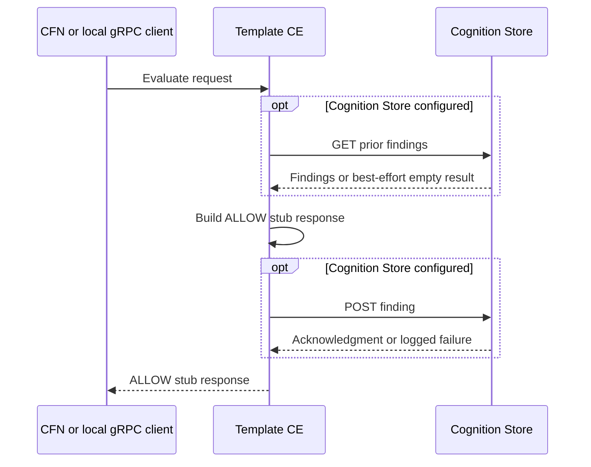

# Template CE

Template CE is a Python starting point for implementing `ioc.ce.v1.CognitionEngine`.
It contains a gRPC service, generated stubs, CFN registration, HTTP health and notifications,
and a Cognition Store client.

## Current behavior

The evaluator is an **always-ALLOW stub**. It optionally fetches prior findings, constructs an ALLOW
response, optionally stores a finding, and returns it. Runtime analytics queries and real checks are left
for the engine author. The outcome values supported by the contract are not implemented decision logic.

Store HTTP failures are handled on a best-effort basis by the client: a failed read becomes empty findings,
and a failed write is logged without changing the stub decision. Do not assume the Go Demo CE's stricter
Store failure behavior applies to this template.

## Use the right engine

Use this template when implementing a new engine. Use [Demo CE](../demo-ce/overview.md) when presenting
configured route and content checks, OXP runtime correlation and colored decision logs.
The root Compose deployment builds only Demo CE; it does not start Template CE.
